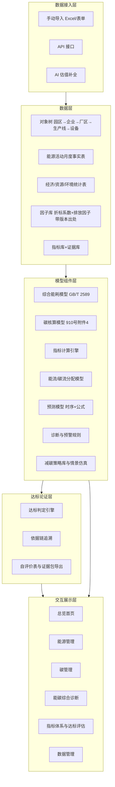
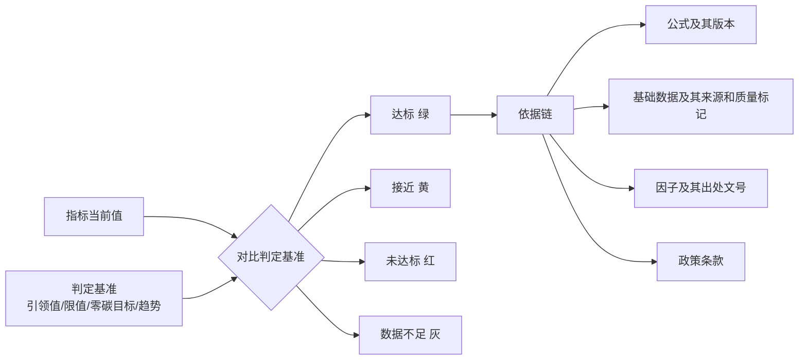

# 信阳经开区绿色园区能碳管理平台：功能、架构与指标体系梳理

> 文档版本：v1.0（2026-10-20）
> 依据：2026-10-20 设计讨论会纪要、`园区能碳管理模型.docx`（核心参考）、`文件/` 目录中的政策原文。
> 目标：统一团队对平台功能、架构和指标体系的理解，作为 Demo 开发的直接输入。早期 md 方案（总稿、架构设计等）偏通用和长期规划，与本文冲突时以本文为准。

---

## 1. 平台定位

一句话定位：**面向国家级绿色工业园区评价的园区能碳管理平台**。

- **业务重心**：深入做能源和碳两大板块，满足纪要中“深耕能源、碳”的要求。
- **其余指标**：产业发展、资源利用、基础设施三类只做轻量展示（摘要数字、录入和佐证），保证绿色园区五类指标都能覆盖。
- **交付意图**：平台要能用数据和依据证明“依据现行政策，本园区相关指标已经达到国家标准”。这一点作为架构中的独立一层来设计（见第 5 章），不能只靠一块看板。
- **平台本身也是加分项**：2026 版评价要求中的第 13 项“园区能碳管理中心功能符合数量”和第 14 项“园区信息平台完善程度”，平台本身就是佐证材料。所以功能清单要对照工信部《工业企业和园区数字化能碳管理中心建设指南》来设计（见 3.3）。

---

## 2. 政策依据：四类文件各管什么

| 作用 | 文件 | 平台中的用途 |
| --- | --- | --- |
| **评价标准（主线）** | 工信厅节函〔2026〕461 号《关于开展 2026 年度绿色工厂推荐和动态管理工作的通知》附件 2《绿色工业园区评价要求》 | 指标体系的主版本：5 个一级指标、19 个二级指标 |
| 评价标准（旧版参考） | 《绿色工厂梯度培育及管理暂行办法》附件 2（旧版评价要求，6 个一级指标、31 个二级指标，带引领值） | 提供引领值、指标解释和计算公式；新版只给了名称和单位 |
| **碳核算方法** | 发改环资〔2025〕910 号《关于开展零碳园区建设的通知》附件 4《零碳园区碳排放核算方法（试行）》 | 园区碳排放 = 能源活动 + 工业过程；电力和热力按“净受入”计算 |
| **能耗计算方法** | GB/T 2589-2020《综合能耗计算通则》 | 综合能耗 E = Σ(Eᵢ × kᵢ)，折标准煤系数取自附录 A |
| **功能规范** | 工信厅节〔2025〕13 号《工业企业和园区数字化能碳管理中心建设指南》 | 定义了 12 项业务功能和 6 层系统架构，用来对照“功能符合数量” |
| 拔高参照 | 910 号附件 3《国家级零碳园区建设指标体系（试行）》 | 单位能耗碳排放 ≤0.2 / ≤0.3 tCO₂/tce 等，作为更高目标线展示 |

> `园区能碳管理模型.docx` 中的核算公式（电力因子 0.8325 kgCO₂/kWh、热力因子 0.11 tCO₂/GJ）就来自 910 号附件 4，折标系数来自 GB/T 2589 附录 A，两者都有出处，可以直接采用。

---

## 3. 指标体系：怎么体现、怎么管理

### 3.1 现行 19 项指标与平台的对应关系

处理方式分四类：
- **深算**：由平台根据能源和碳的明细数据计算，是平台的核心能力。
- **计算**：由统计台账录入后计算。
- **自证**：由平台自身的功能证明。
- **录入**：定性或清单项，录入时附佐证文件。

| 一级 | # | 二级指标（2026 版） | 单位 | 方向 | 处理 | 计算口径（参考旧版解释） | 页面 |
| --- | --- | --- | --- | --- | --- | --- | --- |
| 产业发展 | 1 | 近三年工业总产值年均增长率 | % | 正 | 计算 | (总产值ₜ / 总产值ₜ₋₃)^(1/3) − 1 | 总览小卡 |
| | 2 | 省以上绿色工厂总产值占园区工业总产值比例 | % | 正 | 计算 | Σ绿色工厂产值 / 园区工业总产值 | 总览小卡、绿色认证 |
| | 3 | 高新技术企业工业总产值占园区工业总产值比例 | % | 正 | 计算 | Σ高企产值 / 园区工业总产值 | 总览小卡 |
| 能源利用 | 4 | 能源产出率 | 万元/tce | 正 | **深算** | 工业增加值（不变价）/ 综合能耗 | 总览左侧、能源强度 |
| | 5 | 可再生能源利用率 | % | 正 | **深算** | 可再生能源使用量（tce）/ 综合能耗（tce） | 可再生能源分析 |
| | 6 | 单位产品能源消耗达到 2 级以上企业综合能源消耗占比 | % | 正 | **深算** | Σ(单耗达限额 2 级企业的能耗) / 园区综合能耗 | 能源强度分析 |
| 资源利用 | 7 | 水资源产出率 | 元/m³ | 正 | 计算 | 工业增加值 / 工业新鲜水量 | 总览小卡 |
| | 8 | 土地资源产出率 | 亿元/km² | 正 | 计算 | 工业增加值 / 工业用地面积 | 总览小卡 |
| | 9 | 一般工业固体废弃物综合利用率 | % | 正 | 计算 | 综合利用量 / (产生量 + 利用往年贮存量) | 总览小卡 |
| 基础设施 | 10 | 新建工业建筑中绿色建筑的比例 | % | 正 | 计算 | 认证台账 | 总览小卡、绿色认证 |
| | 11 | 新建公共建筑中绿色建筑的比例 | % | 正 | 计算 | 认证台账 | 同上 |
| | 12 | 园区工业绿色微电网功能符合数量 | 项 | 正 | 录入 | 功能清单逐项勾选并附佐证 | 绿色认证 |
| | 13 | 园区能碳管理中心功能符合数量 | 项 | 正 | **自证** | 对照建设指南的 12 项功能，平台自动统计 | 指标与达标页 |
| | 14 | 园区信息平台完善程度 | % | 正 | **自证** | 平台已上线模块的覆盖率 | 指标与达标页 |
| 生态环境 | 15 | 单位工业增加值废水排放量 | t/万元 | 逆 | 计算 | 工业废水排放量 / 工业增加值 | 总览小卡 |
| | 16 | 主要污染物排放弹性系数 | — | 逆 | 计算 | 各污染物排放量年均增速与增加值年均增速之比，再取平均 | 总览小卡 |
| | 17 | 单位工业增加值二氧化碳排放量 | tCO₂/万元 | 逆 | **深算** | 碳排放量 / 工业增加值 | 总览右侧、碳强度 |
| | 18 | 单位能耗二氧化碳排放量 | tCO₂/tce | 逆 | **深算** | 碳排放量 / 综合能耗（即零碳园区的核心指标） | 总览右侧、碳强度 |
| | 19 | 二氧化碳排放弹性系数 | — | 逆 | **深算** | CO₂ 排放量年均增速 / 工业增加值年均增速 | 碳排放分析 |

**模型文档里需要更新的旧口径**：`园区能碳管理模型.docx` 有部分指标沿用了旧版名称，按 2026 版对照如下。

| 模型文档中的写法（旧版） | 2026 版对应 | 处理建议 |
| --- | --- | --- |
| 绿色产业增加值占园区工业增加值比例 | 第 2 项：省以上绿色工厂总产值占比 | 替换 |
| 可再生能源使用比例 | 第 5 项：可再生能源利用率 | 改名，口径基本一致 |
| 工业固体废弃物综合利用率 | 第 9 项：**一般**工业固体废弃物综合利用率 | 口径收窄，不含危废 |
| 清洁能源使用率 | 新版 19 项中没有 | 保留为能源页的分析指标，零碳园区引导指标要求 ≥90% |
| 单位工业增加值碳减排率 | 新版改为第 19 项弹性系数，加上第 17 项强度 | 保留为分析指标 |
| （未涉及） | 第 6、12、13、14、15、16、19 项 | 需要补充 |

### 3.2 三级指标体系的结构

纪要要求“一、二、三级指标”。规范只给到二级，所以三级定义为**计算二级指标所需的基础统计量**。这样指标树能一直连到数据，下钻也有了落点：

```text
一级：能源利用
 └─ 二级：能源产出率 = 工业增加值 / 综合能耗
     ├─ 三级：工业增加值（万元，不变价）   ← 经济统计台账
     └─ 三级：综合能耗（tce）             ← Σ 各能源品种实物量 × 折标系数
                                            ← 再沿对象树：园区 → 企业 → 厂区 → 生产线 → 设备
```

每一个指标值都能沿“二级 → 三级 → 对象树 → 原始数据”一路下钻。纪要中“多维嵌套模型”和“弹窗下钻”在数据上就是靠这条链实现的。

### 3.3 能碳管理中心 12 项功能的对照（对应第 13 项）

| 指南功能 | 平台位置 | Demo 是否实现 |
| --- | --- | --- |
| 能耗查询 | 能源管理 | ✅ |
| 能源消费量和强度计算 | 能源管理（GB/T 2589） | ✅ |
| 能源消费分析与用能策略推荐 | 能源管理、减碳策略 | ✅ |
| 能效对标 | 能源强度分析（对标限额标准） | ✅ 简版 |
| 能流分析 | 能流网络分析（桑基图） | ✅ |
| 能效平衡与优化 | 减碳策略 | 预留 |
| 用能与碳排放预算管理 | 能碳预测 | ✅ 简版 |
| 碳排放核算 | 碳核算（910 号附件 4） | ✅ |
| 产品碳足迹核算 | — | 预留 |
| 供应链碳管理 | — | 预留 |
| 碳核查支撑 | 证据链与报告导出 | ✅ 简版 |
| 碳资产管理 | — | 预留 |

### 3.4 指标体系管理怎么做

核心原则：**指标是配置数据，不写在代码里**。换标准版本或调整口径时，只改配置，不改程序。

**数据结构（指标域）**

| 表 | 关键字段 | 说明 |
| --- | --- | --- |
| `standard_version` | 版本编码、名称、发文文号、生效年份、状态 | 例如 2024 办法版、2026 版、零碳园区试行版 |
| `indicator_def` | 编码、所属版本、级别、父指标、名称、单位、方向（正/逆）、类型（深算/计算/自证/录入）、公式表达式、解释、佐证要求 | 一、二、三级指标存在同一张表，形成树 |
| `indicator_benchmark` | 指标、基准类型（引领值/限值/零碳目标/历史基线）、数值、比较符、来源文号 | 达标判定的依据，可以有多条 |
| `indicator_value` | 指标、对象节点、期间（月/年）、数值、数据质量标记、计算批次 | 由计算引擎写入，或由人工录入 |
| `evidence_file` | 指标值、文件、上传人、审核状态 | 定性指标和清单类指标的佐证材料 |
| `assessment_result` | 指标、期间、当前值、判定基准、结论（达标/接近/未达标/数据不足）、差距、依据链 | 达标判定结果 |

**管理界面**

1. **指标树**：按版本展示一、二、三级指标，可以编辑名称、单位、方向和类型。
2. **公式配置**：公式引用三级基础量的编码（例如 `IND_EP = ECO_VA / ENG_TCE`）。保存后要经人工审核才生效，满足纪要中“AI 生成的公式必须人工校验”的要求。
3. **基准配置**：为每个指标设置判定基准，并注明来源。
4. **录入与佐证**：录入型指标采用表单加附件上传，再走审核流程。
5. **版本切换**：全平台的达标判定随所选版本重新计算。

---

## 4. 总体架构



与《数字化能碳管理中心建设指南》的 6 层架构对照如下：基础设施层对应服务器和 PostgreSQL；数据采集层对应数据接入层；数据架构层对应数据层；模型组件层相同；业务应用层和互动展示层对应交互展示层。**达标论证层是本项目为验收需要单独增加的一层。**

### 4.1 对象树（多维嵌套的基础）

```text
信阳经开区（园区）
 ├─ 公共区域：管委会办公、公共照明、泵站、交通
 ├─ 绿色家居产业 ─ 企业 ─ 厂区 ─ 生产线（烘干/热压/涂装…） ─ 设备
 └─ 电子信息产业 ─ 企业 ─ 厂区 ─ 生产线（洁净空调/空压机…） ─ 设备
```

- “产业”和“功能模块”（生产/交通/基础设施）作为节点属性，用于分维度汇总，不另建一棵树。
- 所有能源和碳数据挂在任意层级的节点上，向上逐级汇总，指标也可以沿树拆分或聚合。
- 数据只有园区或企业层级时也能运行，下层节点为空就隐藏，即“字段先全后显”。

### 4.2 数据接入与 AI 估值补全

| 方式 | 说明 | 质量标记 |
| --- | --- | --- |
| 手动导入 | Excel 模板导入、表单填报（包括只有发票的情况） | `manual` |
| API 对接 | 企业能管系统、电网、光伏监控等 | `measured` |
| AI 估值补全 | 依据公开的同行业能耗强度和产业统计生成估值，并与园区上报的总量配平 | `estimated` |

AI 估值的规则：
1. 估值数据必须标注来源为生成数据，在界面上显示为虚线或带角标。
2. 估值结果按比例配平，使各企业之和等于园区上报的总能耗和总碳排放。
3. 真实数据到位后自动替换估值，保留历史版本以便对照。
4. **估值数据不能单独作为达标证据**（见 5.3）。

---

## 5. 达标论证层：证明“本园区已达到国家标准”

这是交付验收的核心，在架构中作为独立的一层。

### 5.1 判定逻辑



### 5.2 判定基准的来源

2026 版评价要求**只列出了指标名称和单位，没有给引领值和权重**。通知中的说法是“处于同类园区领先”。因此判定基准做成可配置的多条，每条都写明出处：

| 基准类型 | 示例 | 来源 |
| --- | --- | --- |
| 旧版引领值 | 能源产出率 3 万元/tce、水资源产出率 1500 元/m³、土地产出率 15 亿元/km²、高新产值占比 30%、废水排放 5 t/万元、污染物弹性系数 0.3、新建工业建筑绿建比例 30%、公共建筑 60% | 《绿色工厂梯度培育及管理暂行办法》附件 2 旧版附表 2.1 |
| 零碳园区目标 | 单位能耗碳排放 ≤0.2 tCO₂/tce（年综合能耗 20–100 万 tce 的园区）、清洁能源消费占比 ≥90%、工业固废综合利用率 ≥80% | 发改环资〔2025〕910 号附件 3 |
| 趋势基准 | 单位增加值碳排放逐年下降、弹性系数 < 1 | 历史数据自身比较 |
| 同类园区水平 | 省内或全国同类园区的均值 | 待收集 |

### 5.3 表达上的边界

- 结论统一写成“按 ×× 版本、×× 基准判定为达标”，不写“已通过国家验收”。
- 达标结论如果依赖估值数据，状态显示为“达标（含估值 xx%，待实测确认）”。
- 平台负责计算和展示，指标能否达标由园区实际情况决定。这一责任边界沿用上次纪要。

### 5.4 输出物

1. 首页达标总览：五个一级指标的红黄绿状态，点击进入二级指标。
2. 指标与达标页：19 项逐项列出当前值、基准、结论、差距和依据链。
3. 一键导出《绿色工业园区自评价表》和佐证材料清单，用于在工业节能与绿色发展管理平台（green.miit.gov.cn）上自评价填报。

---

## 6. 页面设计（按 2026-10-20 纪要）

### 6.1 总览首页

```text
┌──────────────────────── 信阳经济技术开发区 ────────────────────────┐
│ [产业发展 ●] [资源利用 ●] [基础设施 ●]  ← 静态代表数字+达标色，点击跳转 │
├──────────────┬────────────────────────┬────────────────────┤
│ 能源（左）    │      园区示意图（中）     │ 碳（右）           │
│ 综合能耗/同比 │  企业点位、产业分区       │ 碳排放总量          │
│ 能源产出率    │  点击企业弹窗下钻         │ 单位增加值碳排放     │
│ 可再生能源利用率│                        │ 单位能耗碳排放       │
│ 清洁能源使用率 │                        │ 绿色认证（工厂/建筑/微电网）│
├──────────────┴────────────────────────┴────────────────────┤
│ 下方：能耗与碳排放月度趋势曲线（近 3 年，叠加达标基准线）            │
└──────────────────────────────────────────────────────────────┘
```

### 6.2 能源管理

| 模块 | 内容 |
| --- | --- |
| 能源消费分析 | 综合能耗总量与趋势；电、热力、汽油、煤、柴油、天然气的占比；清洁能源使用率 |
| 可再生能源分析 | 可再生能源发电量；外购电、光伏、风电、水电、外购绿电的占比；可再生能源利用率 |
| 能源强度分析 | 单位产值能耗（核心）、单位增加值能耗、单位产品能耗及其对标；第 6 项指标 |
| 能流网络分析 | 桑基图。来源（电网/光伏/风/天然气/蒸汽）→ 分配（企业/厂区/生产线，或生产/交通/基础设施）→ 利用（设备） |

模型文档中“IT、制冷、电气损耗”这一组分配维度是数据中心场景的写法。信阳经开区应以“企业 → 厂区 → 生产线”为主，“生产/交通/基础设施”为辅。纪要还提到烘干等高耗能设备，可以作为设备层的重点节点。

### 6.3 碳管理

| 模块 | 内容 |
| --- | --- |
| 碳核算 | 用弹窗展示核算边界、多维嵌套模型、排放因子表、核算依据（910 号附件 4），只体现规则，不展示原始计算过程 |
| 碳排放分析 | 总量与趋势、结构（燃料直接排放/电力间接/热力间接）、强度（第 17、18、19 项）、空间分布 |
| 碳流分析 | 桑基图，与能流一一对应：能流乘以因子得到碳流；绿电、光伏支路显示为 0 排放和抵消量 |

### 6.4 能碳综合诊断（先诊断，后预警）

| 顺序 | 模块 | Demo 实现方式 |
| --- | --- | --- |
| 1 | 根因溯源 | 沿对象树分解贡献度，定位高排放企业、产线和设备；预留碳监测传感器和扩散模型接口，没有硬件也不影响运行 |
| 2 | 能碳预测 | 同时预测能源和碳；采用时序模型（线性趋势或季节分解）加公式推演；做预算对比 |
| 3 | 诊断预警 | 三类预警：指标未达标或接近阈值、趋势恶化、数据缺失；偏离基准超过 10% 时预警 |
| 4 | 减碳策略 | 策略库（光伏扩容、绿电交易、烘干余热回收、空压机变频等），为每条策略设置参数，模拟其对指标的影响并进行对比 |

### 6.5 指标体系与达标评估（新增）

即第 3、5 章的界面落地，包括指标树、基准配置、19 项达标清单、依据链弹窗和自评价表导出。

### 6.6 数据管理（后台）

包括三种接入方式、质量标记看板、估值与替换记录、因子库维护（带版本和出处）、用户权限（管理员/只读）。

---

## 7. Demo 范围（先小后大）

| 项 | Demo 做法 |
| --- | --- |
| 数据 | 模拟数据：1 个园区，约 10 家虚拟企业（家居 5 家、电子 4 家、公共设施 1 个），36 个月的月度数据 |
| 能源品种 | 外购电、光伏自发电、绿电交易、天然气、外购蒸汽、柴油、汽油 |
| 计算链 | 实物量 → 折标（GB/T 2589）→ 综合能耗 → 碳核算（910 号）→ 19 项指标 → 达标判定 |
| 页面 | 总览、能源、碳、诊断（简版）、指标与达标、数据导入 |
| AI 估值 | 先用“行业强度 × 产值，再配平总量”的规则实现，同时预留大模型估值接口 |
| 不做 | 实时采集、生产线级真实能流、碳足迹、碳资产、Agent（后续迭代） |

Demo 的验收标准：从导入一份 Excel 开始，一路走到首页红黄绿结论，并且每个数字都能下钻到它的来源。

---

## 8. 信阳经开区现状（公开资料，待核实）

| 项 | 公开资料 | 状态 |
| --- | --- | --- |
| 级别 | 省级经开区，与羊山新区实行“双轮驱动”管理 | 公开报道 |
| 面积 | 早期方案写 11.7 km²，信阳日报写约 15.6 km² | **冲突，待核实** |
| 主导产业 | 绿色家居、电子信息两大主导产业，另有特色产业现代服务业；分为绿色家居、电子信息、智慧岛、科创部落四大区域 | 公开报道 |
| 家居企业 | 万华生态（无醛板材，2022 年在家居小镇投产）、碧桂园现代筑美、亚丹生态、永豪轩、天一美家、百德木门等 | 公开报道 |
| 电子企业 | 谷麦（半导体封测、显示模组），报道称位于羊山新区，是否在经开区红线内**待核实** | 待核实 |
| 绿色园区 | 2024 年已入选**省级**绿色工业园区，按规定可以冲击国家级 | 2025 年信阳市政府工作报告 |

---

## 9. 待确认与待收集

1. **2026 版评价要求的完整版**：指标解释、计算方法、权重和打分规则，现有附件只有名称和单位。可以找工信部平台的填报说明，或省工信厅的转发件。
2. **河南省绿色工业园区评价细则**和省级推荐口径。
3. **单位产品能耗限额标准**：人造板和家具、电子元器件相关的限额国标，用于第 6 项。
4. **绿色微电网、能碳管理中心的功能符合判定清单**（第 12、13 项）。
5. **电力排放因子口径**：910 号采用全国化石能源电力因子 0.8325；绿色园区评价是否沿用这一口径，还是采用全国电网平均因子，需要确认。平台已经支持按版本切换。
6. **园区真实数据**：企业清单、红线范围、近三年经济、能源、水、固废、废水数据，以及现有能源监测基础。
