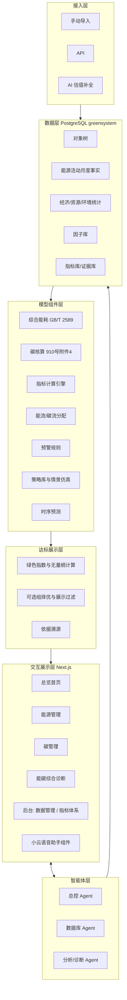

# 信阳经开区绿色园区能碳管理平台：功能、架构与指标体系梳理

> 文档版本：v2.1（2026-10-20）
> 依据：2026-10-20 设计讨论会纪要、`园区能碳管理模型.docx`（核心参考）、`文件/` 目录中的政策原文、2026-10-20 两轮评审意见。
> 用途：统一团队对平台功能、架构和指标体系的理解，作为数据库结构设计的直接输入。早期 md 方案与本文冲突时，以本文为准。
> 企业公开信息见 [园区企业公开信息](园区企业公开信息.md)。

### v2.1 相对 v2.0 的调整

| # | 调整 |
| --- | --- |
| 1 | **指标主版本改为 2026 版**。园区 2024 年已获评省级，现在申报的是 2026 年度；2024 版改为“已达标基线” |
| 2 | 新增 2026 版的评分方式：工信部管理平台在线填报、自动出分；指标带类型、权重和分值；新国标《绿色工业园区评价通则》将按主导产业分类设置引领值 |
| 3 | 大屏标示企业荣誉（省级绿色工厂、零碳工厂等），企业信息单独成文 |
| 4 | Agent 框架确定采用 Pi；新增数据库账户与角色方案（7.4 节） |

### v2.0 相对 v1.0 的调整

| # | 调整 |
| --- | --- |
| 1 | 综合诊断顺序改为：**预警 → 根因溯源 → 减碳策略 → 能碳预测** |
| 2 | 取消单独的“指标与达标”页面。达标指标融入总览、能源、碳页面展示；指标体系的配置放在后台 |
| 3 | “达标判定”改为“达标展示”：依据园区获评省级绿色工业园区时采用的评价要求，只展示达到引领值的指标，不出现“待确认”“未达标”等字样 |
| 4 | 能流和碳流以“企业 → 厂区 → 生产线”为主，“生产/交通/基础设施”为辅（已确认） |
| 5 | 不做模拟数据。下一步先定指标，再设计数据库结构 |
| 6 | 新增技术架构与 Agent 选型（第 7 章） |

---

## 1. 平台定位

一句话定位：**面向绿色工业园区评价的园区能碳管理平台**，用来展示信阳经开区已达到国家绿色工业园区标准的能碳成效。

- **业务重心**：深入做能源和碳两大板块。产业、资源、基础设施、生态环境、运行管理只做摘要展示。
- **交付意图**：信阳经开区已于 **2024 年入选河南省省级绿色工业园区**（见第 8 章），现在按 **2026 年度**评价要求申报。平台按 2026 版指标展示园区的达标成效，包括指标值、得分、所用数据和计算依据；2024 年已达标的成绩作为基线和亮点一并展示。
- **平台本身也是加分项**：评价要求中有“信息平台完善程度”（旧版第 31 项）、“园区能碳管理中心功能符合数量”和“园区信息平台完善程度”（2026 版第 13、14 项）。所以功能清单要对照《工业企业和园区数字化能碳管理中心建设指南》来设计（见 3.5）。

---

## 2. 政策依据

### 2.1 省级绿色工业园区的评审依据（已核实）

| 环节 | 文件 | 要点 |
| --- | --- | --- |
| 河南省推荐通知 | 河南省工信厅办公室《关于组织推荐 2024 年度省级绿色制造名单及前八批绿色制造名单填报动态管理表的通知》（2024-01-22） | 绿色工业园区“参照绿色工业园区评价有关要求进行评价”，提交评价报告（附件 4） |
| 当时有效的评价要求 | 工信部节〔2024〕13 号《绿色工厂梯度培育及管理暂行办法》**附件 2《绿色工业园区评价要求》** | 6 个一级指标、31 个二级指标，带**引领值**；用“工业园区绿色指数”评分 |
| 公示结果 | 2024 年度省级绿色制造名单公示（2024-07）；2025 年信阳市政府工作报告 | 信阳经济技术开发区进入 2024 年度省级绿色工业园区名单，填补了信阳市绿色园区的空白 |

2024 年省级评审采用的是**工信部节〔2024〕13 号附件 2（旧版 31 项及其引领值）**，见 `文件/绿色工业园区/绿色工厂梯度培育及管理暂行办法.pdf` 第 52–55 页。这部分成绩已经达标，在平台中作为**基线**使用。

### 2.2 2026 年度申报依据（主版本）

| 环节 | 文件 | 要点 |
| --- | --- | --- |
| 申报通知 | 工信厅节函〔2026〕461 号（2026-09-24） | 园区对照附件 2 评价要求，在产业发展、能源利用、资源利用、基础设施、生态环境方面处于同类园区领先；登录 green.miit.gov.cn 自评价并提供佐证；省级于 10 月 30 日前推荐 |
| 评价要求 | 461 号附件 2《绿色工业园区评价要求》 | 5 个一级指标、19 个二级指标。本地 PDF 只有名称和单位；黑龙江工信厅 2026-05 转发版带有**指标类型**（正向定量、正向定性、逆向定量、弹性系数）、**权重**和**分值**（例：近三年工业总产值年均增长率，正向定量，权重 4）。完整表待下载核对 |
| 评分方式 | 工信部《2025 年度名单通知》解读（2026-03-18） | 管理平台提供统一的线上评价工具，园区填报数据、上传佐证后**自动生成评价分数** |
| 后续国标 | 《绿色工业园区评价通则》（新制定国标） | 5 个方面 17 个指标，**按园区主导产业分类设置引领值**。发布后作为第三个版本录入 |

**结论**：指标库以 **2026 版为主版本**，计分规则按其类型、权重和分值配置。2024 版作为已达标基线，《评价通则》预留为后续版本。

### 2.3 其他依据

| 作用 | 文件 | 平台中的用途 |
| --- | --- | --- |
| 碳核算方法 | 发改环资〔2025〕910 号附件 4《零碳园区碳排放核算方法（试行）》 | 园区碳排放 = 能源活动 + 工业过程；电力和热力按“净受入”核算 |
| 能耗计算方法 | GB/T 2589-2020《综合能耗计算通则》 | 综合能耗 E = Σ(Eᵢ × kᵢ)，折标系数取附录 A |
| 功能规范 | 工信厅节〔2025〕13 号《工业企业和园区数字化能碳管理中心建设指南》 | 12 项业务功能和 6 层系统架构 |
| 拔高参照 | 910 号附件 3《国家级零碳园区建设指标体系（试行）》 | 只在园区已达到时展示，作为亮点 |

---

## 3. 指标体系

### 3.0 主版本：2026 版 19 项指标

| 一级 | # | 二级指标 | 单位 | 方向/类型 | 平台处理 | 2024 基线中的对应指标 | 展示位置 |
| --- | --- | --- | --- | --- | --- | --- | --- |
| 产业发展 | 1 | 近三年工业总产值年均增长率 | % | 正向定量 | 计算 | — | 总览小卡 |
| | 2 | 省以上绿色工厂总产值占园区工业总产值比例 | % | 正向定量 | 计算 | 绿色产业增加值占比 | 总览小卡、绿色认证、企业标识 |
| | 3 | 高新技术企业工业总产值占园区工业总产值比例 | % | 正向定量 | 计算 | 高新技术产业产值占比 | 总览小卡 |
| 能源利用 | 4 | 能源产出率 | 万元/tce | 正向定量 | **深算** | 能源产出率 | 总览左侧、能源强度 |
| | 5 | 可再生能源利用率 | % | 正向定量 | **深算** | 可再生能源使用比例 | 总览左侧、可再生能源 |
| | 6 | 单位产品能源消耗达到 2 级以上企业综合能源消耗占比 | % | 正向定量 | **深算** | — | 能源强度 |
| 资源利用 | 7 | 水资源产出率 | 元/m³ | 正向定量 | 计算 | 水资源产出率 | 总览小卡 |
| | 8 | 土地资源产出率 | 亿元/km² | 正向定量 | 计算 | 土地资源产出率 | 总览小卡 |
| | 9 | 一般工业固体废弃物综合利用率 | % | 正向定量 | 计算 | 工业固废综合利用率 | 总览小卡 |
| 基础设施 | 10 | 新建工业建筑中绿色建筑的比例 | % | 正向定量 | 计算 | 同名指标 | 绿色认证 |
| | 11 | 新建公共建筑中绿色建筑的比例 | % | 正向定量 | 计算 | 同名指标 | 绿色认证 |
| | 12 | 园区工业绿色微电网功能符合数量 | 项 | 正向（定性/计数） | 录入 | — | 绿色认证 |
| | 13 | 园区能碳管理中心功能符合数量 | 项 | 正向（定性/计数） | **自证** | 信息平台完善程度 | 平台自身 |
| | 14 | 园区信息平台完善程度 | % | 正向定量 | **自证** | 信息平台完善程度 | 平台自身 |
| 生态环境 | 15 | 单位工业增加值废水排放量 | t/万元 | 逆向定量 | 计算 | 同名指标 | 总览小卡 |
| | 16 | 主要污染物排放弹性系数 | — | 弹性系数 | 计算 | 主要污染物弹性系数 | 总览小卡 |
| | 17 | 单位工业增加值二氧化碳排放量 | tCO₂/万元 | 逆向定量 | **深算** | 碳排放量消减率 | 总览右侧、碳强度 |
| | 18 | 单位能耗二氧化碳排放量 | tCO₂/tce | 逆向定量 | **深算** | — | 总览右侧、碳强度 |
| | 19 | 二氧化碳排放弹性系数 | — | 弹性系数 | **深算** | — | 碳排放分析 |

- “方向/类型”是按指标性质和黑龙江转发版片段整理的。**权重和分值需要下载完整附件后补齐。**
- 黑龙江转发版里，第 12、13 项写作“建设园区工业绿色微电网”“建设园区能碳管理中心”（正向定性），和 461 号本地附件的“功能符合数量（项）”写法不同。两者可能是 2025 版和 2026 版的差异，补齐附件时一并核对。
- 能源和碳的**深算指标**是第 4、5、6、17、18、19 项。

### 3.1 已达标基线：旧版 31 项指标与引领值（2024 年省级评审口径）

| 一级 | # | 二级指标 | 单位 | 引领值 | 类型 | 平台处理 | 展示位置 |
| --- | --- | --- | --- | --- | --- | --- | --- |
| 能源利用 EG | 1 | 能源产出率 | 万元/tce | 3 | 必选 | **深算** | 总览左侧、能源强度 |
| | 2 | 可再生能源使用比例 | % | 15 | 必选 | **深算** | 总览左侧、可再生能源 |
| | 3 | 清洁能源使用率 | % | 75 | 必选 | **深算** | 总览左侧、能源消费 |
| 资源利用 RG | 4 | 水资源产出率 | 元/m³ | 1500 | 必选 | 计算 | 总览小卡 |
| | 5 | 土地资源产出率 | 亿元/km² | 15 | 必选 | 计算 | 总览小卡 |
| | 6 | 工业固体废弃物综合利用率 | % | 95 | 必选 | 计算 | 总览小卡 |
| | 7 | 工业用水重复利用率 | % | 90 | 必选 | 计算 | 总览小卡 |
| | 8 | 中水回用率 | % | 30 | 4 选 2 | 计算 | 总览小卡 |
| | 9 | 余热资源回收利用率 | % | 60 | 4 选 2 | 计算 | 总览小卡、能流 |
| | 10 | 废气资源回收利用率 | % | 90 | 4 选 2 | 计算 | 总览小卡 |
| | 11 | 再生资源回收利用率 | % | 80 | 4 选 2 | 计算 | 总览小卡 |
| 基础设施 IG | 12 | 污水集中处理设施 | — | 具备 | 必选 | 录入 | 总览小卡 |
| | 13 | 新建工业建筑中绿色建筑的比例 | % | 30 | 2 选 1 | 计算 | 绿色认证 |
| | 14 | 新建公共建筑中绿色建筑的比例 | % | 60 | 2 选 1 | 计算 | 绿色认证 |
| | 15 | 500 米公交站点覆盖率 | % | 90 | 2 选 1 | 计算 | 总览小卡 |
| | 16 | 节能与新能源公交车比例 | % | 30 | 2 选 1 | 计算 | 总览小卡 |
| 产业 CG | 17 | 高新技术产业产值占园区工业总产值比例 | % | 30 | 必选 | 计算 | 总览小卡 |
| | 18 | 绿色产业增加值占园区工业增加值比例 | % | 30 | 必选 | 计算 | 总览小卡 |
| | 19 | 人均工业增加值 | 万元/人 | 15 | 2 选 1 | 计算 | 总览小卡 |
| | 20 | 现代服务业比例 | % | 30 | 2 选 1 | 计算 | 总览小卡 |
| 生态环境 HG | 21 | 工业固体废弃物（含危废）处置利用率 | % | 100 | 必选 | 计算 | 总览小卡 |
| | 22 | 万元工业增加值碳排放量消减率 | % | 3 | 必选 | **深算** | 总览右侧、碳强度 |
| | 23 | 单位工业增加值废水排放量（逆向） | t/万元 | 5 | 必选 | 计算 | 总览小卡 |
| | 24 | 主要污染物弹性系数（逆向） | — | 0.3 | 必选 | 计算 | 总览小卡 |
| | 25 | 园区空气质量优良率 | % | 80 | 必选 | 录入 | 总览小卡 |
| | 26 | 绿化覆盖率 | % | 30 | 3 选 1 | 计算 | 总览小卡 |
| | 27 | 道路遮荫比例 | % | 80 | 3 选 1 | 计算 | 总览小卡 |
| | 28 | 露天停车场遮荫比例 | % | 80 | 3 选 1 | 计算 | 总览小卡 |
| 运行管理 MG | 29 | 绿色工业园区标准体系完善程度 | — | 完善 | 必选 | 录入 | 总览小卡 |
| | 30 | 编制绿色工业园区发展规划 | — | 是 | 必选 | 录入 | 总览小卡 |
| | 31 | 绿色工业园区信息平台完善程度 | — | 完善 | 必选 | **自证** | 总览小卡（平台本身） |

- 参评的是 24 项：21 项必选，加上 4 选 2、2 选 1、2 选 1、2 选 1、3 选 1 共 6 项可选。旧纪要中的“风水四项指标选两项”，指的就是第 8–11 项“4 项指标选 2 项”。
- 能源和碳相关的**深算指标**是第 1、2、3、22 项，加上可选的第 9 项（余热）。平台还会深算 2026 版的单位工业增加值 CO₂ 排放量、单位能耗 CO₂ 排放量和 CO₂ 排放弹性系数，作为碳页面的分析指标。
- **基本要求**第 2 条要求“近三年碳排放强度持续下降”，在碳页面用近三年月度和年度强度曲线来体现。

### 3.2 评分方法：工业园区绿色指数

```text
GI = (100 / 24) × Σ 无量纲值
正向指标：无量纲值 = 指标值 / 引领值
逆向指标（第 23、24 项）：无量纲值 = 引领值 / 指标值
定性指标（具备 / 完善 / 是）：符合时记 1
```

每项无量纲值 ≥ 1，表示该指标**达到国家引领值**。

### 3.3 达标展示规则

1. **只展示达标指标**。
   - 2026 版：前台展示得分达到满分或优秀档的指标（按 2026 版权重和分值计分），以及总分。
   - 2024 基线：展示无量纲值 ≥ 1 的指标，标注“达到国家引领值（工信部节〔2024〕13 号）”。
   - 没有达标的指标不在前台展示，也不出现“未达标”“待确认”等字样。
2. **可选组自动择优**。4 选 2、2 选 1、3 选 1 由园区按规定自选，平台自动选出表现最好的指标参评。
3. **绿色指数按需展示**。绿色指数 GI 和零碳园区等拔高指标，只在达到时才作为亮点展示。展示开关在后台配置。
4. **数据来源标记保留在后台**。纪要要求 AI 估值必须标注为生成数据。这一标记保留在数据层，只在数据管理后台和依据溯源中出现，不出现在达标卡片上。
5. **以真实数据为准**。哪些指标出现在前台，由园区实际数据计算决定。平台只控制展示范围，不改动数值。

### 3.4 新旧版本口径对照（可自行核对）

你可以对照两个文件核对：
- **模型文档**：`园区能碳管理模型.docx`，页面一“中”第 ②、⑥ 条，页面二“可再生能源”第 ③ 条。
- **2026 新版**：`文件/绿色工业园区/附件2 绿色工业园区评价要求.pdf`。
- **2024 旧版**：`文件/绿色工业园区/绿色工厂梯度培育及管理暂行办法.pdf` 第 53 页附表 2.1。

| 模型文档写法（与 2024 旧版一致） | 2026 新版对应 | 说明 |
| --- | --- | --- |
| 绿色产业增加值占园区工业增加值比例 | 省以上绿色工厂总产值占园区工业总产值比例 | 指标改了 |
| 可再生能源使用比例 | 可再生能源利用率 | 改名 |
| 工业固体废弃物综合利用率 | 一般工业固体废弃物综合利用率 | 口径收窄 |
| 清洁能源使用率 | 新版没有 | — |
| 单位工业增加值碳减排率 | 新版改为单位工业增加值 CO₂ 排放量、CO₂ 排放弹性系数 | — |

**结论**：模型文档采用的是 2024 旧版口径。园区现在按 2026 年度申报，所以**模型文档要按上表改成 2026 版的指标名称和口径**。旧口径作为 2024 基线保留在指标库中。

### 3.5 能碳管理中心 12 项功能对照

| 指南功能 | 平台位置 |
| --- | --- |
| 能耗查询 | 能源管理 |
| 能源消费量和强度计算 | 能源管理（GB/T 2589） |
| 能源消费分析与用能策略推荐 | 能源管理、减碳策略 |
| 能效对标 | 能源强度分析 |
| 能流分析 | 能流网络分析 |
| 能效平衡与优化 | 减碳策略 |
| 用能与碳排放预算管理 | 能碳预测 |
| 碳排放核算 | 碳核算 |
| 产品碳足迹核算 | 预留 |
| 供应链碳管理 | 预留 |
| 碳核查支撑 | 依据溯源、报告导出 |
| 碳资产管理 | 预留 |

### 3.6 指标体系管理（后台）

指标是配置数据，不写在代码里，并且多版本并存。

| 表 | 关键字段 | 说明 |
| --- | --- | --- |
| `standard_version` | 编码、名称、发文文号、年份、是否为展示主版本 | 2026 版（主）、2024 版（基线）、评价通则（预留）、零碳园区试行版 |
| `indicator_def` | 编码、版本、级别、父指标、名称、单位、方向、选择组（必选/4 选 2…）、处理类型、公式、解释、佐证要求、展示位置 | 一、二、三级指标存在同一张表，形成树 |
| `indicator_benchmark` | 指标、基准类型（引领值/零碳目标）、数值、来源文号和页码 | 可以有多条 |
| `indicator_value` | 指标、对象节点、期间、数值、无量纲值、计算批次 | 由计算引擎写入或人工录入 |
| `evidence_file` | 指标值、文件、审核状态 | 定性指标的佐证材料 |
| `indicator_mapping` | 2024 版指标 ↔ 2026 版指标 | 跨版本对照 |

**三级指标**指计算二级指标所需的基础量。例如：能源产出率拆成工业增加值和综合能耗；综合能耗再拆成各能源品种实物量 × 折标系数，并沿对象树一直拆到设备。

后台功能：
- 指标树维护
- 公式配置（人工审核后才生效）
- 引领值维护
- 定性指标录入与佐证
- 前台展示开关

---

## 4. 总体架构



### 4.1 对象树（已确认采用）

```text
信阳经开区
 ├─ 公共区域（管委会、照明、泵站、交通）
 ├─ 绿色家居 ─ 企业 ─ 厂区 ─ 生产线（烘干/热压/涂装…） ─ 重点设备
 └─ 电子信息 ─ 企业 ─ 厂区 ─ 生产线（洁净空调/空压机…） ─ 重点设备
```

- 能流和碳流以“企业 → 厂区 → 生产线”为主。
- “生产/交通/基础设施”作为节点的功能属性，用于辅助汇总。

### 4.2 数据接入

| 方式 | 说明 | 来源标记（后台） |
| --- | --- | --- |
| 手动导入 | Excel 模板、表单、发票凭证 | `manual` |
| API | 企业能管系统、电网、光伏监控 | `measured` |
| AI 估值补全 | 依据同行业园区公开数据和产业能耗强度生成，与园区上报总量配平；拿到真实数据后自动替换 | `estimated` |

---

## 5. 页面设计

### 5.1 总览首页

```text
┌──────────────────────── 信阳经济技术开发区 ────────────────────────┐
│ [产业发展] [资源利用] [基础设施]  ← 已达到引领值的代表指标，点击跳转     │
├──────────────┬────────────────────────┬────────────────────┤
│ 能源（左）    │      园区示意图（中）     │ 碳（右）           │
│ 综合能耗 同比 │  家居/电子两大产业分区    │ 碳排放总量          │
│ 能源产出率 ✓  │  企业点位，点击弹窗下钻   │ 单位增加值CO₂排放 ✓  │
│ 可再生能源利用率 ✓│  企业荣誉标识：         │ 单位能耗CO₂排放 ✓    │
│ 清洁能源使用率 │  省级绿色工厂/零碳工厂等 │ 绿色认证（工厂/建筑/微电网）│
├──────────────┴────────────────────────┴────────────────────┤
│ 下方：能耗与碳排放月度趋势（近 3 年）                              │
└──────────────────────────────────────────────────────────────┘
```

✓ 表示达标标签，只在达标时出现。园区示意图上的企业点位挂荣誉标识，例如谷麦光电、星原智能（2024 年省级绿色工厂），星原智能、螓杰智能（河南省第一批零碳工厂）。完整清单见 [园区企业公开信息](园区企业公开信息.md)。

### 5.2 能源管理

| 模块 | 内容 | 融入的达标指标 |
| --- | --- | --- |
| 能源消费分析 | 总量与趋势；电、热力、汽油、煤、柴油、天然气的占比 | 清洁能源使用率 |
| 可再生能源分析 | 发电量；外购电、光伏、风、水、外购绿电的占比 | 可再生能源使用比例 |
| 能源强度分析 | 单位产值能耗（核心）、单位增加值能耗、单位产品能耗及其对标 | 能源产出率 |
| 能流网络分析 | 桑基图：来源 → 企业 / 厂区 / 生产线 → 设备 | 余热资源回收利用率（如参评） |

### 5.3 碳管理

| 模块 | 内容 | 融入的达标指标 |
| --- | --- | --- |
| 碳核算 | 用弹窗展示边界、多维嵌套模型、因子和依据，只体现规则 | — |
| 碳排放分析 | 总量、结构、强度、空间分布；近三年强度持续下降曲线 | 万元工业增加值碳排放量消减率；基本要求“碳排放强度持续下降” |
| 碳流分析 | 与能流一一对应，显示绿电和光伏带来的抵消量 | — |

### 5.4 能碳综合诊断（预警 → 根因溯源 → 减碳策略 → 能碳预测）

| 顺序 | 模块 | 作用 |
| --- | --- | --- |
| 1 | 诊断预警 | 发现问题：能耗或碳排异常、超出预算、趋势偏离，偏离基准超过 10% 时预警 |
| 2 | 根因溯源 | 追查原因：沿对象树分解贡献度，定位高排放的企业、产线和设备；预留碳监测传感器和扩散模型接口 |
| 3 | 减碳策略 | 给出对策：从策略库（光伏扩容、绿电交易、烘干余热回收、空压机变频等）匹配方案 |
| 4 | 能碳预测 | 验证效果：预测能源和碳排放的基准情景，以及各策略实施后的情景，并与预算对比 |

### 5.5 后台

- 数据管理：三种接入方式、来源标记、估值替换记录、因子库。
- 指标体系管理：见 3.6。
- 用户权限。

---

## 6. 下一步：数据库结构设计

指标确认后，按以下表组在 `greensystem` 中设计 schema。暂不填充模拟数据。

| 表组 | 主要表 |
| --- | --- |
| 对象与维度 | 园区、企业、厂区、生产线、设备（对象树）、行业、功能属性、期间 |
| 能源与碳事实 | 能源活动月度事实（品种、实物量、折标、来源标记）、电力和热力受入送出、碳核算结果 |
| 统计台账 | 产值、增加值、用水、用地、固废、废水、污染物、建筑认证、绿色工厂认证 |
| 因子库 | 折标系数、排放因子（带版本、出处、生效期） |
| 指标库 | 3.6 中的六张表 |
| 诊断 | 预警规则与记录、策略库、预测结果 |
| 接入与审计 | 导入批次、API 任务、估值记录、操作审计 |
| Agent | 会话、工具调用日志、只读查询视图 |

---

## 7. 技术架构与 Agent 选型（讨论稿）

### 7.1 前端

- 整站采用 **Next.js**（App Router），后端 API 和服务端渲染都在同一工程内完成。
- **注意**：Next.js 基于 React，Vue3 组件不能直接在其中使用。建议图表用 **ECharts + React 封装**（`echarts-for-react` 或自行封装 hook）。ECharts 的配置写法和 Vue 版完全一致，桑基图、地图、仪表盘都支持。
- 如果团队坚持用 Vue3，整站应改用 **Nuxt 3**，不要在 Next.js 里混用 Vue。

### 7.2 Agent 框架：Pi 与 Claude Agent SDK 对比

| 维度 | Pi（pi-ai + pi-agent-core） | Claude Agent SDK |
| --- | --- | --- |
| 语言和嵌入方式 | TypeScript 库，可以直接嵌在 Next.js 服务端 | 通过子进程运行 Claude Code 运行时，偏向文件和命令行任务 |
| 模型 | 多家模型可选，兼容所有 OpenAI 格式接口，**可以接国产大模型或私有化部署的模型** | 只能用 Claude 模型（官方 API、Bedrock、Vertex） |
| 内置能力 | 精简：只有 Agent 循环、工具调用和事件流，权限、子 Agent、编排需要自己写 | 完整：子 Agent、hooks、权限、MCP、会话管理都有 |
| 适用场景 | 网站内的数据库查询 Agent、语音助手后端、总控编排 | 研发期的自动化，例如数据库迁移、代码生成 |
| 风险 | 项目较新，2026 年 5 月已从个人仓库迁到 Earendil 公司 | 政务项目部署在国内时，模型访问和数据出境合规是硬约束 |

**已确定（2026-10-20）**：网站运行时的三个 Agent（数据库 Agent、语音助手后端、总控 Agent）采用 **Pi**。理由是它能嵌进 Next.js，模型可以替换成国产模型，符合园区数据不出境的要求。研发阶段可以继续用 Claude 系工具辅助开发。

Agent 只能调用受限的查询工具和只读视图，不能自己拼写 SQL。这一点与 `docs/多项目数据库与数据库Agent方案.md` 的设计一致。

**需要确认**：部署后用哪个大模型，这决定了 Pi 的接入配置。

### 7.3 小云语音助手

需要拿到该组件的接入文档，包括 SDK 形式、语音转文字由谁完成、回调接口。之后再确定它与总控 Agent 的接口。

### 7.4 数据库账户与角色方案（建议，待确认后创建）

**现状（2026-10-20 实测）**：
- 通过 SSH 隧道（本机 15432 端口），`zyz` 和 `postgres` 都能连上 `greensystem`。
- 库内还没有业务表。可用扩展有 `timescaledb`、`pg_trgm`、`pgcrypto`，没有 `pgvector`。
- `zyz` 现在具有 `CREATEDB` 属性，和早先的记录不同。

**结论：Agent 不用超级管理员 `postgres`，也不长期用 `zyz`。** 全自动管理数据库的流程是“入库 → 清洗 → 标识 → 自然语言业务处理 → 自动更新”，每一步都只需要固定范围的权限，所以按职责拆成几个角色。这样自动化程度不受影响，Agent 出错时影响也有限。

| 角色 | 谁使用 | 权限 | 说明 |
| --- | --- | --- | --- |
| `postgres` | 人工管理员 | 超级用户 | 只用于建角色、装扩展、备份恢复，不交给任何 Agent 或网站 |
| `greensystem`（现有库所有者） | 迁移流程 | 拥有业务 schema，执行 DDL | 数据库 Agent 生成迁移 SQL，经审查后用此角色执行 |
| `green_etl` | 数据管道 Agent | `raw`、`core`、`fact` 的写入；不能执行 DDL，不能物理删除 | 负责入库、清洗、来源标记、估值替换；需要删除时只做软删除 |
| `green_app` | Next.js 网站 | 业务读写（按页面需要授权） | 网站运行账户。开发期可以暂用 `zyz` |
| `green_agent_ro` | 自然语言查询 Agent | 只能 `SELECT` `mart` 视图；设置语句超时和行数上限 | 小云语音、总控 Agent 查数据都走这个角色 |

**schema 规划**：

| schema | 用途 |
| --- | --- |
| `raw` | 数据湖，存原始导入 |
| `core` | 对象树、因子、指标定义 |
| `fact` | 月度事实 |
| `mart` | 面向页面和 Agent 的视图 |
| `agent` | 会话与工具调用日志 |
| `audit` | 操作审计 |

**其他事项**：
- 角色创建和授权由管理员一次性执行，需要你确认后再做。
- 角色密码只保存在本机 `.env` 或服务器环境变量中，不进仓库。
- 建议同时收回 `zyz` 的 `CREATEDB`。

---

## 8. 信阳经开区现状（公开资料）

| 项 | 信息 | 来源 |
| --- | --- | --- |
| 级别与管理 | 省级开发区，与羊山新区实行“双轮驱动”管理机制（一套班子抓全局，一套班子抓产业） | 信阳日报 2023-09-19 |
| 面积 | **规划总面积约 15.6 平方公里**。早期方案里的 11.7 km² 没有找到出处，应弃用 | 信阳日报 2023-09-19 |
| 产业与分区 | 绿色家居、电子信息两大主导产业，另有特色产业现代服务业；分为绿色家居、电子信息、智慧岛、科创部落四大区域 | 同上 |
| 家居企业 | 万华生态集团（家居小镇，2022-04 投产，总投资 20 亿元，年产值超百亿元）、现代筑美家居（碧桂园旗下）、亚丹生态家居、永豪轩（河南家具出口第一）、天一美家、百德木门 | 同上 |
| 电子企业 | 谷麦光电（半导体封装、显示器件，专精特新“小巨人”）、今上半导体（信阳）；创伟达、螓杰、星原智能等入驻羊山新区 | 同上 |
| 绿色制造 | 2024 年度省级绿色工业园区，现申报 2026 年度；园区企业荣誉见企业信息文档 | 2024 省级名单公示 |
| 片区构成 | 绿色家居片区在羊山新区家居小镇；电子信息片区在金牛园区（谷麦注册在金牛产业集聚区，星原智能被报道为位于“信阳经开区金牛园区电子科技园”）。金牛并入经开区的批复文件尚未找到 | 信阳日报、企业工商信息 |
| 集群 | 绿色家居产业集群为省级中小企业特色产业集群、全国 41 个家具产业集群之一 | 信阳日报；2025 年市政府工作报告 |

> 公开资料没有给出经开区的完整企业名录和规上企业数。“羊山新区”和“经开区”的企业有时混写，以园区管委会提供的名录为准。

---

## 9. 待收集

1. 园区 2024 年省级绿色工业园区的**评价报告**（如能拿到，各指标的实际值和绿色指数可以直接作为展示基线）。
2. 园区企业名录、规上企业清单、红线范围图。
3. 近三年的经济、能源、水、固废、废水、污染物统计数据。
4. 部署所用的大模型，以及小云语音助手的接入文档。
