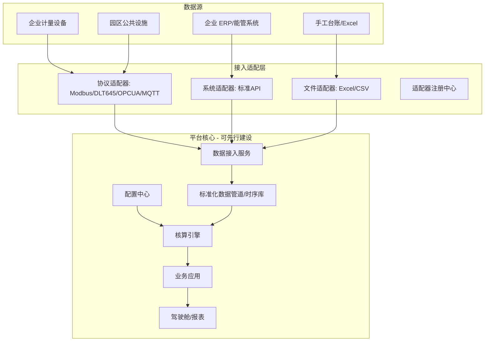
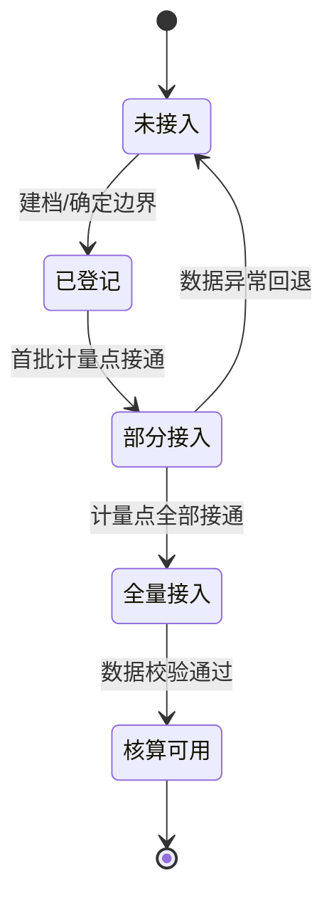

# 能碳管理平台「框架先行 · 数据滚动接入」技术方案

> 版本：v0.1｜配套文档：《能碳管理平台系统架构设计方案.md》
> 适用场景：平台先行建设，各企业计量/数据逐步到位后滚动上线，避免"等数据齐了才能用"。

---

## 1. 设计目标

1. **框架先行**：平台本体（数据中台 + 应用层 + 展示层 + 配置中心）先建好、跑通、可演示；
2. **即插即用**：新企业、新计量点、新能源品种接入时不改核心代码；
3. **滚动上线**：数据到位一家、接入一家、点亮一家，互不阻塞；
4. **不等数据**：数据未就绪的企业/计量点，不阻塞平台整体运行与其它企业的核算。

---

## 2. 四条核心原则

| 原则 | 含义 | 落地手段 |
| --- | --- | --- |
| 解耦 | 数据接入与业务应用完全解耦 | 接入适配层独立，业务只消费"标准化数据" |
| 配置驱动 | 一切可变皆配置，不写死 | 元数据化 + 配置中心 + 自助配置界面 |
| 就绪度管理 | 按企业/计量点追踪接入状态 | 数据就绪度状态机，独立滚动推进 |
| 容忍缺失 | 缺数据不阻塞，结果带完整度标记 | 占位渲染 + 覆盖度标注 + 手工兜底 |

---

## 3. 架构设计

在原五层总体架构基础上，突出两个关键层：**接入适配层**（即插即用）与**配置中心**（元数据驱动）。

**要点**：虚线框内（平台核心）可以先建好并空转；数据源通过"适配器"按需接入，接入顺序、接入数量不影响平台核心的稳定性。

---

## 4. 关键机制设计

### 4.1 数据接入适配器（插件化）

- **适配器注册机制**：每种协议/系统对应一个适配器插件，通过注册中心动态加载、启停、版本管理；
- **覆盖三类接入**：
  - 设备接入：Modbus / DL/T 645 / OPC UA / MQTT；
  - 系统接入：企业 ERP / 能管系统通过标准 API 对接；
  - 文件接入：Excel / CSV 批量导入（含手工台账兜底）；
- **新类型零改核心**：新设备协议或新系统只需开发一个新适配器并注册，平台核心、核算引擎、驾驶舱均无需改动。

### 4.2 企业数据就绪度状态机

每个企业独立维护一个状态，滚动推进、互不影响：

- 平台整体上线不要求所有企业都到"核算可用"，只要至少一家试点企业跑通即可；
- 驾驶舱对未接入/部分接入企业显示"就绪度"标签与覆盖率，而非报错。

### 4.3 配置驱动（元数据化）

以下全部作为配置项，通过配置中心 + 自助配置界面维护，**运营人员可自助完成，无需开发介入**：

- 企业档案与核算边界（含/不含某区域、某能源品种）；
- 计量点（编码、能源品种、倍率、位置、所属企业/区域）；
- 排放因子（版本化，见主方案第 5 章）；
- 指标与报表模板、告警阈值；
- 用户与数据权限（企业只能看自身数据）。

### 4.4 手工导入兜底通道

- 在自动采集未接通前，支持 Excel/手工台账录入能源消耗数据，让平台**先能算、先能出报告**；
- 自动采集逐步替代手工：同一计量点，自动数据到位后自动切换并保留历史对照。

### 4.5 数据缺失容忍策略

| 场景 | 处理方式 |
| --- | --- |
| 企业完全未接入 | 不参与核算汇总；驾驶舱显示"待接入"占位 |
| 企业部分接入 | 核算该企业时标注"数据覆盖率 xx%"，结果带完整度提示 |
| 计量点数据缺失 | 数据质量校验标记"缺失/异常"，可人工补录或按规则插补并留痕 |
| 因子暂缺 | 禁止核算并提示，避免用错误因子算出"假数据" |

---

## 5. 标准接入模板（规范化对接）

为让"到位即接入"可复制、可验收，沉淀三份标准模板：

1. **数据字典标准**：能源品种编码、计量点编码、单位、口径统一；
2. **企业数据对接接口规范**：API 字段、频率、鉴权、幂等与补传约定；
3. **接入验收清单**：计量器具是否按 GB 17167 配备、倍率核对、边界确认、试算比对。

企业接入 = "按模板对接 + 通过验收清单"，形成标准化流水线。

---

## 6. 上线节奏设计

| 阶段 | 交付内容 | 可上线标志 |
| --- | --- | --- |
| A 框架搭建 | 数据中台、应用骨架、配置中心、权限、驾驶舱空壳 | 系统可空转、可演示 |
| B 接入能力 | 适配器、三套模板、自助配置界面 | 具备"即插即用"能力 |
| C 试点跑通 | 选 1–2 家标杆企业接通数据、跑通核算→报表→驾驶舱全链路 | **平台正式上线** |
| D 滚动接入 | 其余企业按模板批量接入 | 就绪度逐步点亮 |
| E 持续运营 | 因子更新、新企业/新设备持续接入 | 常态化运营 |

**关键结论**：平台上线门槛设在"阶段 C 试点企业跑通"，而非"所有企业数据齐全"——后续企业数据到位即接入、接入即上线。

---

## 7. 关键技术风险与应对

| 风险 | 影响 | 应对 |
| --- | --- | --- |
| 接入协议碎片化 | 每家接入成本高 | 适配器插件化 + 标准模板，新协议只加插件 |
| 企业数据质量参差 | 核算不可信 | 接入验收清单前置 + 数据质量校验 |
| 元数据配置失控 | 配置错误难追溯 | 配置版本化 + 变更审批 + 审计 |
| 空转期无业务价值感知 | 各方信心不足 | 试点先行，先出"标杆企业"成果再推广 |
| 手工兜底数据不可靠 | 结果失真 | 手工数据标记来源，自动数据到位后自动比对替换 |

---

## 8. 与总体方案的衔接

本方案是《能碳管理平台系统架构设计方案.md》的**补充设计**，不改变总体分层与功能划分，仅强化：

- 在感知层与平台层之间明确"接入适配层"；
- 新增"配置中心"作为横向支撑；
- 将"企业数据就绪度"作为滚动上线的核心管理对象。

> 后续可根据实际招标要求、试点企业范围与接入优先级，进一步细化接口字段、配置项清单与验收标准。
