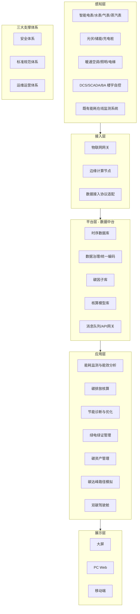
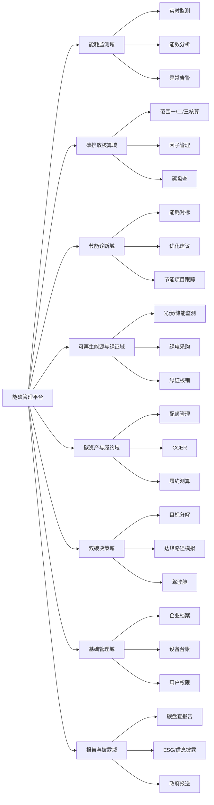
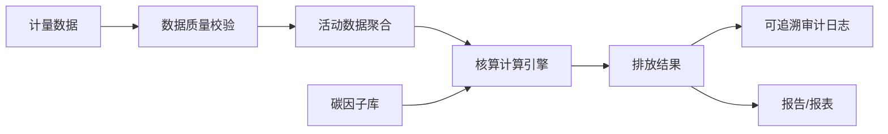
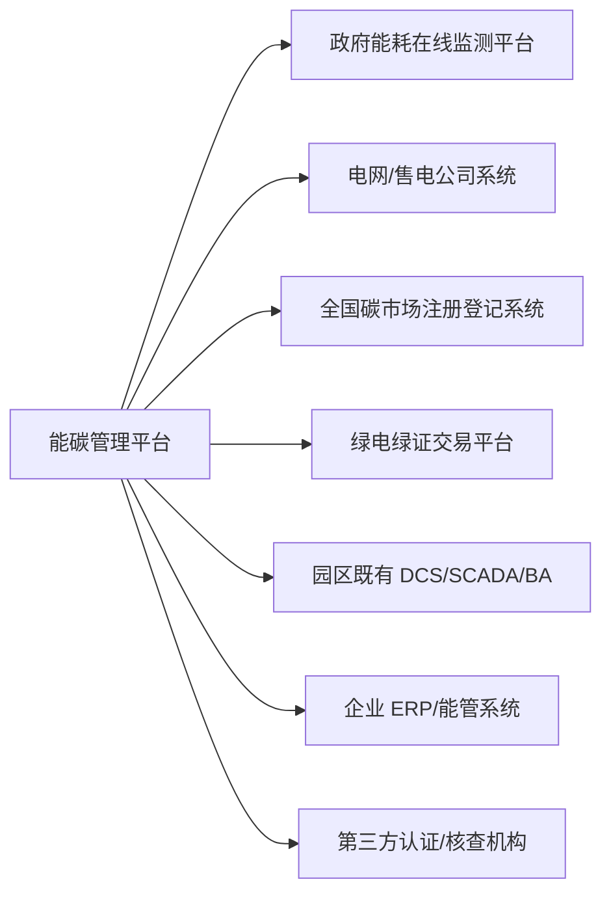
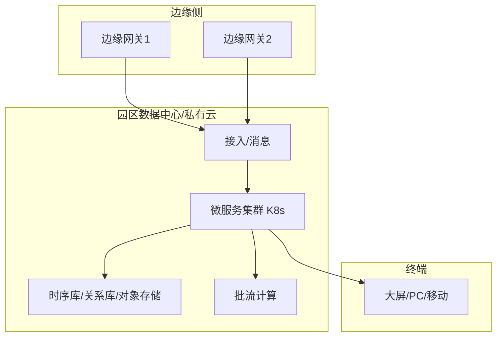

# 绿色工业园区能碳管理平台 系统架构设计方案

> 版本：v0.1（从零起草）｜ 适用对象：多企业集聚型工业园区 / 产业园
> 文档定位：指导开发的技术设计文档，覆盖总体架构、业务/应用/数据/技术/集成/部署/安全与演进路线。

---

## 目录

1. 建设目标与范围界定
2. 总体架构
3. 业务架构（功能模块划分）
4. 应用架构（模块详细设计）
5. 碳核算引擎设计（核心）
6. 数据架构与数据模型
7. 技术架构与选型
8. 集成架构（外部系统对接）
9. 部署架构
10. 安全架构
11. 非功能需求
12. 建设分期与演进路线
13. 关键技术风险与应对

---

## 1. 建设目标与范围界定

### 1.1 建设目标

在「双碳」目标与全国碳市场、绿电绿证交易机制背景下，为工业园区构建统一的能碳数字化底座，实现：

- **测得准**：园区公共设施 + 入驻企业用能数据的统一采集、计量与在线监测；
- **算得清**：按国家标准对园区及企业进行碳排放核算（范围一 / 二 / 三）；
- **管得住**：能效诊断、节能优化建议、降碳目标分解与跟踪；
- **运营得了**：绿电绿证管理、碳资产（配额 / CCER）登记与履约支持；
- **看得见**：面向管委会 / 运营方 / 企业的多级驾驶舱与报表。

### 1.2 三类服务对象（需求分层）

| 角色 | 核心诉求 | 对应模块 |
| --- | --- | --- |
| 园区管委会 / 政府 | 区域能耗与碳排放总览、双碳考核、政策对标 | 监管驾驶舱、核算总账、对标考核 |
| 园区运营方 | 公共设施节能降耗、绿电采购、碳资产管理 | 能效分析、绿电绿证、碳资产 |
| 入驻企业 | 自身能碳盘查、节能诊断、履约与披露 | 企业工作台、碳盘查、ESG 报告 |

### 1.3 核算边界（先定清楚）

- **空间边界**：园区红线内；公共区域 + 各入驻企业，二者分开核算、可向上汇总。
- **能源品种**：电、水、天然气、蒸汽/热力、油品、可再生能源（光伏/储能/充电桩）。
- **温室气体范围**：
  - 范围一：园区内直接燃烧（燃气锅炉、备用柴油发电机等）产生的排放；
  - 范围二：外购电力、外购热力/蒸汽产生的间接排放；
  - 范围三：供应链、通勤、废弃物处理等其它间接排放（作为可选扩展）。
- **对标标准**：ISO 50001（能源管理体系）、ISO 14064-1 / GHG Protocol（温室气体核算）、GB/T 32150、GB/T 32151 系列、GB 17167（计量器具配备）、工信部《绿色园区评价要求》。

---

## 2. 总体架构

采用「云—边—端」一体化、分层解耦的总体架构，自上而下分为 **感知层、接入层、平台层、应用层、展示层**，横切 **安全体系、标准规范体系、运维运营体系** 三大支撑。



### 2.1 分层职责

- **感知层**：能源计量与用能设备，是数据源头；必须满足 GB 17167 计量器具配备要求。
- **接入层**：负责多协议接入（Modbus / DL/T 645 / OPC UA / MQTT / HTTP）、边缘预处理（断点续传、就地缓存、异常标记）。
- **平台层（数据中台）**：数据的统一汇聚、治理、编码、时序存储，以及碳因子库与核算模型库两大数据资产。
- **应用层**：面向三类用户的业务能力，微服务化、可插拔。
- **展示层**：多终端一致的数据可视化。

---

## 3. 业务架构（功能模块划分）

按「能—碳—资产—决策」四条主线划分 8 个业务域：



---

## 4. 应用架构（模块详细设计）

### 4.1 能耗监测域

- **实时监测**：按园区 / 区域 / 企业 / 车间 / 设备五级下钻，支持分能源品种、分时（峰谷平）、分项（照明、空调、动力、特殊）监测。
- **能效分析**：单位产值/单位面积/单位产品能耗强度指标，同比/环比、行业对标。
- **异常告警**：阈值告警、突增突减识别、计量异常（倍率错误、反相）诊断，通过规则引擎 + 简单统计模型实现。

### 4.2 碳排放核算域（详见第 5 章）

- 组织级核算（园区整体 + 各企业）、因子库管理、年度碳盘查流程。

### 4.3 节能诊断域

- 能耗对标（对标国家/行业限额与标杆值）；
- 基于规则的节能机会识别（如空压机启停优化、照明时控、分时电费优化）；
- 节能项目立项、节能量跟踪与效益核算。

### 4.4 可再生能源与绿证域

- 光伏/储能/充电桩运行监测与发电量、减排量统计；
- 绿电采购合同、绿证核销台账；
- 可再生能源消纳比例、自发自用率计算（用于范围二排放抵扣口径）。

### 4.5 碳资产与履约域

- 配额账户管理、CCER 开发/持有台账、履约缺口测算与交易提示。

### 4.6 双碳决策域

- 双碳目标分解到年度/企业/能源品种；
- **碳达峰路径模拟**：基于情景（基准情景、节能情景、绿电替代情景、深度脱碳情景）做排放预测，辅助决策。

### 4.7 基础管理域

- 企业档案、计量器具与设备台账、组织与权限（RBAC + 多租户）、审计日志。

### 4.8 报告与披露域

- 自动生成碳盘查报告、ESG / 信息披露表、对接政府能耗在线监测平台与碳市场报送接口。

---

## 5. 碳核算引擎设计（核心）

碳核算引擎是本平台的灵魂，必须做到「核算口径可配置、因子可追溯、结果可审计」。

### 5.1 核算公式（基本模型）

```text
温室气体排放量 = Σ (活动数据 AD × 排放因子 EF × 全球增温潜势 GWP)
```

- **活动数据 AD**：来自感知层采集的能源消耗量（电 kWh、天然气 m³、蒸汽 t 等），须与计量数据对齐；
- **排放因子 EF**：来自碳因子库，按能源品种/区域电网/年份维护；
- **GWP**：统一折算为 CO₂e（二氧化碳当量），默认采用 IPCC AR5/AR6 对应的 GWP 值。

### 5.2 范围一 / 二 / 三核算逻辑

| 范围 | 活动数据来源 | 排放因子示例 |
| --- | --- | --- |
| 范围一（直接） | 燃气表、油品台账 | 天然气低位发热量 × 单位热值含碳量 × 碳氧化率 |
| 范围二（外购电/热） | 电表、蒸汽表 | 区域电网排放因子（国家/省级更新值） |
| 范围三（其它间接） | 台账、估算模型 | 采购/通勤/废弃物（作为可选模块） |

### 5.3 碳因子库设计

- **字段**：因子编码、能源品种、适用范围（国家/省级/行业）、数值、单位、来源（发文文号）、生效日期、版本、审核状态；
- **版本化**：因子变更不覆盖历史记录，核算结果按当时生效因子归档，保证历史报告可复现；
- **审批流**：因子新增/变更需走「编辑—审核—发布」，发布后不可直接修改。

### 5.4 核算引擎运行机制



- **可追溯性**：每笔核算结果记录「数据来源批次 + 因子版本 + 计算公式版本 + 计算时间」，支持一键回放重算；
- **口径切换**：支持组织边界（含/不含某企业）、区域因子/国家因子、范围三可选等口径的灵活切换；
- **批量重算**：因子或口径调整后，支持按时间范围批量重算并生成差异比对。

---

## 6. 数据架构与数据模型

### 6.1 数据分层

```text
ODS（原始接入层） → DWD（明细/清洗层） → DWS（汇总层） → ADS（应用指标层）
```

- **ODS**：物联网原始报文、计量原始读数，保留原始值；
- **DWD**：清洗、去重、补缺、异常标记、单位统一；
- **DWS**：按 时间/区域/企业/能源品种/分项 多维汇总；
- **ADS**：面向驾驶舱与报表的指标结果。

### 6.2 核心数据模型（关键实体）

| 实体 | 关键字段 | 说明 |
| --- | --- | --- |
| 企业/租户 | org_id, 名称, 行业, 边界配置 | 多租户隔离根 |
| 计量点 | meter_id, 能源品种, 倍率, 位置, 所属区域/企业 | 数据采集最小单元 |
| 计量读数 | meter_id, ts, 读数, 质量标记 | 时序数据（时序库存储） |
| 设备台账 | device_id, 类型, 额定参数, 运行状态 | 设备与计量点关联 |
| 排放因子 | factor_id, 品种, 适用范围, 数值, 版本 | 碳因子库 |
| 核算任务 | calc_id, 边界, 因子版本, 时间范围, 状态 | 核算批次 |
| 核算结果 | calc_id, 范围, 品种, 排放量, CO₂e | 可追溯结果 |
| 配额/CCER 台账 | asset_id, 类型, 数量, 来源, 状态 | 碳资产 |

### 6.3 时序数据存储

- 计量读数、设备运行状态等高频数据存入时序数据库（支持百万级点位、秒级采样、自动降采样）；
- 冷热分层：近期高频数据热存，历史数据降采样归档，控制存储成本。

### 6.4 数据治理要点

- **统一编码**：能源品种编码、计量点编码、区域/企业编码全局唯一；
- **数据质量**：缺失、突跳、负值、倍率异常等自动校验与人工补录；
- **血缘**：报表指标 → 核算结果 → 明细数据 → 原始读数的完整血缘。

---

## 7. 技术架构与选型

### 7.1 总体技术路线

- **后端**：微服务架构（Spring Cloud / 或云原生 K8s + Service Mesh），服务按业务域拆分，支持独立部署与弹性伸缩；
- **前端**：B/S 架构，大屏 / PC / 移动端统一 API 后端；
- **数据库**：关系库（PostgreSQL/MySQL）+ 时序库（InfluxDB / TDengine）+ 对象存储 + 缓存（Redis）；
- **消息**：MQTT（设备接入）+ Kafka/RocketMQ（数据管道）+ 规则引擎（告警）；
- **计算**：离线/批量核算（Spark/Flink 批处理）+ 实时流计算（Flink）用于实时监测指标。

### 7.2 关键技术组件

| 能力 | 技术选型（参考） | 说明 |
| --- | --- | --- |
| 设备接入 | 物联网平台 / 自研接入服务 | 多协议解析、设备管理 |
| 边缘计算 | 边缘网关容器 | 断点续传、本地缓存、就地告警 |
| 时序存储 | TDengine / InfluxDB | 高频计量数据 |
| 数据管道 | Kafka / RocketMQ | 削峰、解耦 |
| 批/流计算 | Flink / Spark | 核算与实时指标 |
| 数字孪生 | 三维引擎（如 Three.js / Unity）+ GIS | 能源流向可视化 |
| AI 预测 | 时序预测模型（负荷/碳排放预测） | 达峰路径模拟 |
| 可信存证 | 数据哈希上链（可选） | 碳数据防篡改、可审计 |

### 7.3 关键算法能力

- **负荷/碳排放预测**：时间序列模型（LSTM / Prophet / 回归），支撑达峰模拟；
- **异常识别**：阈值 + 统计（分位数、变化率）+ 简单 ML 分类；
- **节能优化**：规则库 + 运筹优化（如分时用电调度）作为后续增强。

---

## 8. 集成架构（外部系统对接）



| 对接对象 | 方向 | 数据/用途 | 接口方式 |
| --- | --- | --- | --- |
| 政府能耗在线监测平台 | 上报 | 园区能耗汇总 | HTTP/文件报文，按政务规范 |
| 电网/售电公司 | 获取 | 购电结算、绿电属性 | API / EDI |
| 全国碳市场注册登记系统 | 交互 | 配额、履约信息 | 平台提供的接口/人工导入 |
| 绿电绿证交易平台 | 交互 | 绿证核销 | API |
| DCS/SCADA/BA | 获取 | 生产与暖通运行数据 | OPC UA / Modbus |
| 企业 ERP/能管系统 | 双向 | 产量、活动数据 | API / 文件 |
| 核查/认证机构 | 提供 | 核算底稿导出 | 导出/受控访问 |

- 统一通过 **API 网关 + 集成服务** 管理，接口鉴权、限流、日志、报文留痕；
- 对外上报采用可配置模板，适配不同政务报送格式变化。

---

## 9. 部署架构

- **模式一（推荐）**：园区私有化部署 + 边缘节点。核心数据不出园区，满足能源数据安全与企业隐私要求；
- **模式二**：政务云/行业云部署（多园区 SaaS 化），通过多租户隔离支撑多园区复用；
- **边缘**：在关键能耗区域部署边缘网关，断网时可本地缓存与告警，联网后补传。



- 高可用：核心服务与数据库主备/多副本，接入与消息层集群化；
- 灾备：数据定期备份与异地容灾（视等级保护要求）。

---

## 10. 安全架构

- **等级保护**：按等保 2.0 三级要求设计（身份鉴别、访问控制、安全审计、入侵防范、数据完整性/保密性）；
- **身份与权限**：统一身份认证（支持对接政务/企业 SSO）、RBAC + 多租户数据隔离、细粒度数据权限（管委会看汇总、企业只看自身）；
- **数据安全**：传输加密（TLS）、存储加密、敏感字段脱敏、操作留痕；
- **接口安全**：API 鉴权（OAuth2/JWT）、限流、防重放、报文签名；
- **可信存证**（可选）：核算结果哈希上链或存证服务，防止篡改，支撑核查审计。

---

## 11. 非功能需求

| 指标 | 要求（参考） |
| --- | --- |
| 接入规模 | 支持 ≥ 10 万计量点位，秒级采集 |
| 数据完整性 | 采集缺失自动补传，数据完整率 ≥ 99% |
| 响应时间 | 常规查询 ≤ 2s，大屏实时刷新 ≤ 5s |
| 核算准确性 | 与人工核算结果偏差 ≤ 1%（同口径） |
| 可用性 | 核心服务 ≥ 99.9% |
| 扩展性 | 支持新增企业/计量点/能源品种，不停机扩展 |
| 兼容性 | 多协议设备接入、多浏览器、国产化软硬件适配 |

---

## 12. 建设分期与演进路线

### 一期（底座 + 能碳监测）

- 数据接入与计量改造、统一编码与数据治理；
- 能耗监测、能效分析、范围二碳排放核算、监管驾驶舱。

### 二期（碳核算 + 节能）

- 范围一/三核算、碳因子库与核算引擎完整化、碳盘查报告；
- 节能诊断、对标与优化建议、数字孪生可视化。

### 三期（资产 + 决策）

- 绿电绿证、碳资产与履约管理；
- 碳达峰路径模拟、AI 预测、可信存证、ESG 披露。

---

## 13. 关键技术风险与应对

| 风险 | 影响 | 应对 |
| --- | --- | --- |
| 计量数据质量差/器具未配备 | 核算不可信 | 先做计量普查与补装，数据质量校验前置 |
| 排放因子口径混乱 | 结果争议 | 因子库集中管理 + 版本化 + 审批 |
| 企业数据不愿上平台 | 采集覆盖不全 | 多租户隔离、最小必要采集、保密协议 |
| 政务报送格式多变 | 对接成本高 | 可配置报文模板 + 集成服务解耦 |
| 核算是"事后"无降碳抓手 | 平台成摆设 | 从监测延伸到节能诊断与达峰决策闭环 |

---

> 本方案为 v0.1 从零起草稿，后续可根据实际招标要求、园区现状调研与核算口径访谈迭代细化。
