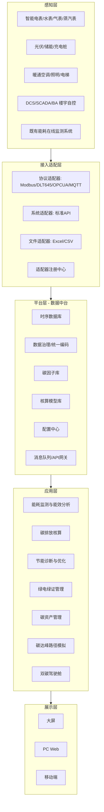
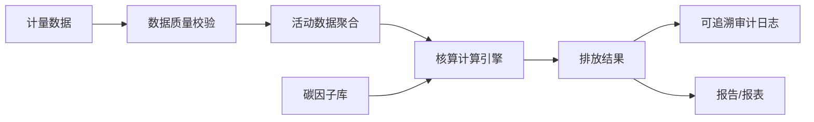
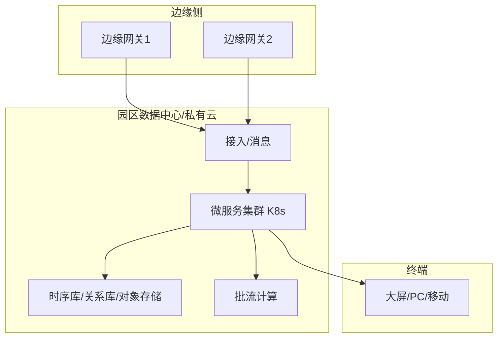
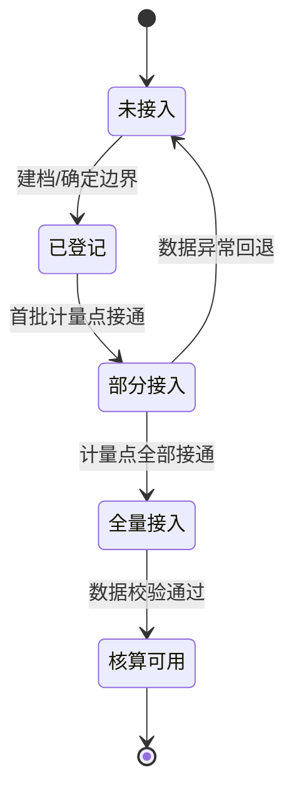

# 信阳经开区能碳管理平台建设方案（总稿）

> 版本：v1.0 整合稿｜由《系统架构设计方案》《框架先行数据滚动接入技术方案》《信阳经开区实施方案（实例化）》三稿合并、去重、重组而成。
> 面向对象：信阳经济技术开发区（省级经开区，2021 年设立，规划面积 11.7 平方公里）。

---

## 目录

1. 项目概述
2. 现状与需求分析
3. 总体架构
4. 业务架构（功能模块）
5. 应用架构（模块详细设计）
6. 碳核算引擎设计
7. 数据架构
8. 技术架构与选型
9. 集成架构
10. 部署架构
11. 安全架构
12. 非功能需求
13. 框架先行 · 数据滚动接入设计
14. 信阳经开区落地实施
15. 建设分期与演进路线
16. 关键风险与应对
17. 待调研核实清单

---

## 1. 项目概述

### 1.1 园区概况

| 项目 | 内容 |
| --- | --- |
| 园区名称 | 信阳经济技术开发区 |
| 级别 | 省级经开区（2021 年 1 月河南省政府批复设立） |
| 规划面积 | 11.7 平方公里 |
| 主导产业 | 绿色家居、电子信息 |
| 头部企业 | 万华生态、亚丹生态、碧桂园现代筑美；谷麦光电、今上半导体 |

> 标注「待核实」的信息（企业清单、规上企业数等）见第 17 章调研清单。

### 1.2 建设目标

在双碳目标与全国碳市场、绿电绿证交易机制背景下，为信阳经开区构建统一能碳数字化底座，实现「测得准、算得清、管得住、运营得了、看得见」：

- 园区公共设施与入驻企业用能数据的统一采集、计量与在线监测；
- 按国家标准对园区及企业进行碳排放核算（范围一 / 二 / 三）；
- 能效诊断、节能优化、降碳目标分解与跟踪；
- 绿电绿证管理、碳资产（配额 / CCER）登记与履约支持；
- 面向管委会 / 运营方 / 企业的多级驾驶舱与报表。

### 1.3 建设原则

1. **框架先行**：平台本体先建好、跑通、可演示，企业数据到位一家、接入一家、点亮一家，不"等数据齐了才上线"；
2. **即插即用**：新企业、新计量点、新能源品种接入不改核心代码；
3. **配置驱动**：企业边界、计量点、因子、指标、权限全部元数据化，运营人员自助配置；
4. **标准合规**：核算与计量对标国家标准，结果可追溯、可审计。

---

## 2. 现状与需求分析

### 2.1 两大主导产业的能源特征（信阳经开区关键差异）

| 产业 | 主要用能 | 排放侧重 | 节能抓手 |
| --- | --- | --- | --- |
| 绿色家居（人造板/家具制造） | 电 + 天然气/蒸汽（干燥、热压、涂装固化） | 范围一（天然气直燃）+ 范围二（电） | 干燥/热压余热回收、热风系统优化、除尘风机变频 |
| 电子信息（光电/半导体封装） | 电为主（洁净空调、空压机、工艺设备） | 范围二（外购电）绝对主导 | 洁净空调群控、空压机余热回收、分时用电 |

**设计含义**：

- 能源品种必须同时覆盖**电力、天然气、蒸汽/热力**（家居产业链需要蒸汽/天然气，仅做"电表"会漏掉范围一）；
- 电子企业核算重点在范围二，家居企业需同时做范围一，核算引擎须两者都支持；
- 节能诊断按产业配置两套规则，而非一套通用规则。

### 2.2 三类服务对象需求

| 角色 | 核心诉求 | 对应模块 |
| --- | --- | --- |
| 园区管委会 / 政府 | 能耗与碳排放总览、双碳考核、绿色园区申报 | 监管驾驶舱、核算总账、对标考核 |
| 园区运营方 | 公共设施节能降耗、绿电采购、碳资产管理 | 能效分析、绿电绿证、碳资产 |
| 入驻企业 | 自身能碳盘查、节能诊断、履约与披露 | 企业工作台、碳盘查、ESG 报告 |

### 2.3 核算边界与对标标准

- **空间边界**：经开区红线内 11.7 平方公里，分「公共区域 + 各入驻企业」两本账，可向上汇总；
- **能源品种**：电力、天然气、蒸汽/热力、水（水不直接算碳排放，纳入能效监测）；
- **温室气体范围**：范围一（燃气直燃、备用发电机）、范围二（外购电/热力）、范围三（供应链/通勤/废弃物，二期可选扩展）；
- **对标标准**：ISO 50001、ISO 14064-1 / GHG Protocol、GB/T 32150、GB/T 32151 系列、GB 17167（计量器具配备）、工信部《绿色园区评价要求》、河南省/信阳市双碳与"十四五"能耗双控考核口径。

---

## 3. 总体架构

采用「云—边—端」一体化、分层解耦架构，自上而下分为 **感知层、接入适配层、平台层、应用层、展示层**，横切 **安全体系、标准规范体系、运维运营体系** 三大支撑。



### 3.1 分层职责

- **感知层**：能源计量与用能设备，须满足 GB 17167 计量器具配备要求；
- **接入适配层**：多协议接入（Modbus / DL/T 645 / OPC UA / MQTT / HTTP）、边缘预处理（断点续传、就地缓存、异常标记），新协议/新系统只加适配器、不改核心；
- **平台层（数据中台）**：数据统一汇聚、治理、编码、时序存储，沉淀碳因子库、核算模型库两大数据资产，并通过配置中心支撑元数据驱动；
- **应用层**：面向三类用户的业务能力，微服务化、可插拔；
- **展示层**：多终端一致的可视化。

---

## 4. 业务架构（功能模块）

按「能—碳—资产—决策」四条主线划分 8 个业务域：

| 业务域 | 核心功能 |
| --- | --- |
| 能耗监测域 | 实时监测、能效分析、异常告警 |
| 碳排放核算域 | 范围一/二/三核算、因子管理、碳盘查 |
| 节能诊断域 | 能耗对标、优化建议、节能项目跟踪 |
| 可再生能源与绿证域 | 光伏/储能监测、绿电采购、绿证核销 |
| 碳资产与履约域 | 配额管理、CCER、履约测算 |
| 双碳决策域 | 目标分解、达峰路径模拟、驾驶舱 |
| 基础管理域 | 企业档案、设备台账、用户权限 |
| 报告与披露域 | 碳盘查报告、ESG/信息披露、政府报送 |

---

## 5. 应用架构（模块详细设计）

### 5.1 能耗监测域

- **实时监测**：按园区/区域/企业/车间/设备五级下钻，分能源品种（电/气/蒸汽/水）、分时（峰谷平）、分项（照明、空调、动力、特殊）监测；
- **能效分析**：单位产值/单位面积/单位产品能耗强度，同比/环比、行业对标；
- **异常告警**：阈值告警、突增突减识别、计量异常（倍率错误、反相）诊断，规则引擎 + 统计模型实现。

### 5.2 碳排放核算域

详见第 6 章碳核算引擎设计。

### 5.3 节能诊断域（按产业两套规则）

- **绿色家居**：干燥/热压余热回收、热风系统优化、除尘风机变频、燃气锅炉效率；
- **电子信息**：洁净空调群控、空压机余热回收、分时用电调度、变压器经济运行；
- 能耗对标国家/行业限额与标杆值，节能项目立项、节能量跟踪与效益核算。

### 5.4 可再生能源与绿证域

光伏/储能/充电桩运行监测与发电量、减排量统计；绿电采购合同、绿证核销台账；可再生能源消纳比例、自发自用率计算（用于范围二排放抵扣口径）。

### 5.5 碳资产与履约域

配额账户管理、CCER 开发/持有台账、履约缺口测算与交易提示。

### 5.6 双碳决策域

双碳目标分解到年度/企业/能源品种；碳达峰路径模拟（基准/节能/绿电替代/深度脱碳四情景）；驾驶舱。

### 5.7 基础管理域

企业档案、计量器具与设备台账、组织与权限（RBAC + 多租户）、审计日志。

### 5.8 报告与披露域

自动生成碳盘查报告、ESG/信息披露表、对接政府能耗在线监测平台与碳市场报送接口。

---

## 6. 碳核算引擎设计（核心）

### 6.1 核算公式（基本模型）

```text
温室气体排放量 = Σ (活动数据 AD × 排放因子 EF × 全球增温潜势 GWP)
```

- **活动数据 AD**：来自感知层采集的能源消耗量（电 kWh、天然气 m³、蒸汽 t 等）；
- **排放因子 EF**：来自碳因子库，按能源品种/区域电网/年份维护；
- **GWP**：统一折算为 CO₂e，默认采用 IPCC AR5/AR6 对应 GWP 值。

### 6.2 范围一 / 二 / 三核算逻辑

| 范围 | 活动数据来源 | 排放因子示例 |
| --- | --- | --- |
| 范围一（直接） | 燃气表、油品台账 | 天然气低位发热量 × 单位热值含碳量 × 碳氧化率 |
| 范围二（外购电/热） | 电表、蒸汽表 | 区域电网排放因子（国家/省级更新值） |
| 范围三（其它间接） | 台账、估算模型 | 采购/通勤/废弃物（可选模块） |

### 6.3 碳因子库设计

- **字段**：因子编码、能源品种、适用范围（国家/省级/行业）、数值、单位、来源、生效日期、版本、审核状态；
- **版本化**：因子变更不覆盖历史记录，核算结果按当时生效因子归档，历史报告可复现；
- **审批流**：因子新增/变更走「编辑—审核—发布」，发布后不可直接修改。

### 6.4 核算引擎运行机制



- **可追溯性**：每笔结果记录「数据来源批次 + 因子版本 + 计算公式版本 + 计算时间」，支持一键回放重算；
- **口径切换**：支持组织边界、区域因子/国家因子、范围三可选等口径灵活切换；
- **批量重算**：因子或口径调整后，按时间范围批量重算并生成差异比对。

---

## 7. 数据架构

### 7.1 数据分层

```text
ODS（原始接入层） → DWD（明细/清洗层） → DWS（汇总层） → ADS（应用指标层）
```

### 7.2 核心数据模型（关键实体）

| 实体 | 关键字段 | 说明 |
| --- | --- | --- |
| 企业/租户 | org_id, 名称, 行业, 边界配置 | 多租户隔离根 |
| 计量点 | meter_id, 能源品种, 倍率, 位置, 所属区域/企业 | 数据采集最小单元 |
| 计量读数 | meter_id, ts, 读数, 质量标记 | 时序数据（时序库存储） |
| 设备台账 | device_id, 类型, 额定参数, 运行状态 | 设备与计量点关联 |
| 排放因子 | factor_id, 品种, 适用范围, 数值, 版本 | 碳因子库 |
| 核算任务 | calc_id, 边界, 因子版本, 时间范围, 状态 | 核算批次 |
| 核算结果 | calc_id, 范围, 品种, 排放量, CO₂e | 可追溯结果 |
| 配额/CCER 台账 | asset_id, 类型, 数量, 来源, 状态 | 碳资产 |

### 7.3 时序数据存储与治理

- 计量读数等高频数据入时序库（百万级点位、秒级采样、自动降采样）；冷热分层，历史数据降采样归档控成本；
- **统一编码**：能源品种/计量点/区域/企业编码全局唯一；
- **数据质量**：缺失、突跳、负值、倍率异常自动校验与人工补录；
- **血缘**：报表指标 → 核算结果 → 明细数据 → 原始读数的完整血缘。

---

## 8. 技术架构与选型

- **后端**：微服务架构（Spring Cloud / 云原生 K8s），按业务域拆分，独立部署与弹性伸缩；
- **前端**：B/S 架构，大屏/PC/移动端统一 API 后端；
- **数据存储**：关系库（PostgreSQL/MySQL）+ 时序库（TDengine/InfluxDB）+ 对象存储 + 缓存（Redis）；
- **消息**：MQTT（设备接入）+ Kafka/RocketMQ（数据管道）+ 规则引擎（告警）；
- **计算**：Flink 实时流 + Spark 批处理。

| 能力 | 技术选型（参考） |
| --- | --- |
| 设备接入 | 物联网平台/自研接入服务（多协议解析） |
| 边缘计算 | 边缘网关容器（断点续传、本地缓存） |
| 时序存储 | TDengine / InfluxDB |
| 数据管道 | Kafka / RocketMQ |
| 批/流计算 | Flink / Spark |
| 数字孪生 | 三维引擎 + GIS |
| AI 预测 | 时序预测模型（负荷/碳排放预测） |
| 可信存证 | 数据哈希上链（可选） |

---

## 9. 集成架构

| 对接对象 | 方向 | 数据/用途 | 接口方式 |
| --- | --- | --- | --- |
| 政府能耗在线监测平台 | 上报 | 园区能耗汇总 | HTTP/文件报文 |
| 电网/售电公司 | 获取 | 购电结算、绿电属性 | API / EDI |
| 全国碳市场注册登记系统 | 交互 | 配额、履约信息 | 平台接口/人工导入 |
| 绿电绿证交易平台 | 交互 | 绿证核销 | API |
| DCS/SCADA/BA | 获取 | 生产与暖通运行数据 | OPC UA / Modbus |
| 企业 ERP/能管系统 | 双向 | 产量、活动数据 | API / 文件 |
| 核查/认证机构 | 提供 | 核算底稿导出 | 导出/受控访问 |

统一通过 **API 网关 + 集成服务** 管理，鉴权、限流、日志、报文留痕；对外上报采用可配置模板，适配政务报送格式变化。

---

## 10. 部署架构

- **模式一（推荐）**：园区私有化部署 + 边缘节点，核心数据不出园区，满足能源数据安全与企业隐私要求；
- **模式二**：政务云/行业云部署（多园区 SaaS 化），多租户隔离支撑复用；
- **边缘**：关键能耗区域部署边缘网关，断网本地缓存与告警，联网补传。



高可用：核心服务与数据库主备/多副本，接入与消息层集群化；灾备：定期备份与异地容灾（视等保要求）。

---

## 11. 安全架构

- **等级保护**：按等保 2.0 三级设计（身份鉴别、访问控制、安全审计、入侵防范、数据完整性/保密性）；
- **身份与权限**：统一身份认证（对接政务/企业 SSO）、RBAC + 多租户隔离、细粒度数据权限（管委会看汇总、企业只看自身）；
- **数据安全**：传输加密（TLS）、存储加密、敏感字段脱敏、操作留痕；
- **接口安全**：API 鉴权（OAuth2/JWT）、限流、防重放、报文签名；
- **可信存证**（可选）：核算结果哈希上链或存证服务，防篡改、支撑核查审计。

---

## 12. 非功能需求

| 指标 | 要求（参考） |
| --- | --- |
| 接入规模 | ≥ 10 万计量点位，秒级采集 |
| 数据完整性 | 采集缺失自动补传，完整率 ≥ 99% |
| 响应时间 | 常规查询 ≤ 2s，大屏实时刷新 ≤ 5s |
| 核算准确性 | 与人工核算偏差 ≤ 1%（同口径） |
| 可用性 | 核心服务 ≥ 99.9% |
| 扩展性 | 新增企业/计量点/能源品种不停机扩展 |
| 兼容性 | 多协议设备、多浏览器、国产化软硬件适配 |

---

## 13. 框架先行 · 数据滚动接入设计

### 13.1 四条核心原则

| 原则 | 含义 | 落地手段 |
| --- | --- | --- |
| 解耦 | 数据接入与业务应用完全解耦 | 接入适配层独立，业务只消费标准化数据 |
| 配置驱动 | 一切可变皆配置，不写死 | 元数据化 + 配置中心 + 自助配置界面 |
| 就绪度管理 | 按企业/计量点追踪接入状态 | 数据就绪度状态机，独立滚动推进 |
| 容忍缺失 | 缺数据不阻塞，结果带完整度标记 | 占位渲染 + 覆盖度标注 + 手工兑底 |

### 13.2 数据接入适配器（插件化）

- **适配器注册机制**：每种协议/系统对应一个适配器插件，通过注册中心动态加载、启停、版本管理；
- **覆盖三类接入**：设备接入（Modbus / DL/T 645 / OPC UA / MQTT）、系统接入（企业 ERP/能管标准 API）、文件接入（Excel/CSV，含手工台账兑底）；
- **新类型零改核心**：新协议/新系统只开发一个新适配器并注册，平台核心、核算引擎、驾驶舱均无需改动。

### 13.3 企业数据就绪度状态机



平台整体上线不要求所有企业到「核算可用」，至少一家试点企业跑通即可；驾驶舱对未接入/部分接入企业显示就绪度标签与覆盖率。

### 13.4 配置驱动（元数据化）

以下全部作为配置项，运营人员自助维护，无需开发介入：企业档案与核算边界、计量点（编码/品种/倍率/位置）、排放因子、指标与报表模板、告警阈值、用户与数据权限。

### 13.5 手工导入兑底通道

自动采集未接通前，支持 Excel/手工台账录入能耗数据，让平台先能算、先能出报告；自动数据到位后自动切换并保留历史对照。

### 13.6 数据缺失容忍策略

| 场景 | 处理方式 |
| --- | --- |
| 企业完全未接入 | 不参与核算汇总；驾驶舱显示「待接入」占位 |
| 企业部分接入 | 核算时标注「数据覆盖率 xx%」，结果带完整度提示 |
| 计量点数据缺失 | 数据质量校验标记缺失/异常，可人工补录或插补留痕 |
| 因子暂缺 | 禁止核算并提示，避免用错误因子算出假数据 |

### 13.7 标准接入模板

沉淀三份标准模板：数据字典标准、企业数据对接接口规范、接入验收清单（计量器具按 GB 17167 配备、倍率核对、边界确认、试算比对）。企业接入 = 按模板对接 + 通过验收清单，形成标准化流水线。

---

## 14. 信阳经开区落地实施

### 14.1 试点企业选择（两条产业线标杆）

| 试点 | 建议企业（候选） | 代表意义 | 验证重点 |
| --- | --- | --- | --- |
| 标杆 1 | 万华生态 / 亚丹生态（绿色家居） | 范围一+范围二核算、蒸汽/天然气计量、余热节能诊断 | 多能源品种接入、直燃排放核算 |
| 标杆 2 | 谷麦光电 / 今上半导体（电子信息） | 纯电力、范围二核算、空压机/空调节能诊断 | 高频电耗监测、分时用电优化 |

> 试点选择标准：计量基础较好、能耗规模较大、配合意愿强。

### 14.2 数据滚动接入优先级

1. **第一批（试点）**：2 家标杆企业 + 园区公共设施（管委会办公楼、公共照明、泵站）；
2. **第二批（头部企业）**：其余头部企业（碧桂园现代筑美、今上半导体等）按模板批量接入；
3. **第三批（规上企业）**：其余规模以上企业，优先自动采集，辅以手工台账兑底；
4. **第四批（中小微）**：计量薄弱企业，先手工台账/Excel，自动采集逐步补齐。

### 14.3 上线节奏

| 阶段 | 交付内容 | 信阳经开区落地动作 | 可上线标志 |
| --- | --- | --- | --- |
| A 框架搭建 | 数据中台、应用骨架、配置中心、权限、驾驶舱空壳 | 在经开区/政务云部署平台底座 | 系统可空转演示 |
| B 接入能力 | 适配器、三套模板、自助配置界面 | 完成电力/天然气/蒸汽三类协议适配器 | 具备即插即用能力 |
| C 试点跑通 | 2 家标杆企业全链路 | 万华/亚丹 + 谷麦/今上各选 1 家接通，跑通计量→核算→报告→驾驶舱 | **平台正式上线** |
| D 滚动接入 | 其余企业按模板批量接入 | 头部→规上→中小微滚动推进 | 就绪度逐步点亮 |
| E 持续运营 | 因子更新、新企业接入 | 对标绿色园区申报、双碳考核 | 常态化运营 |

**关键结论**：上线门槛设在「阶段 C 试点跑通」，而非所有企业数据齐全——后续企业数据到位即接入、接入即上线。

### 14.4 对标与考核落地

- **绿色园区申报**：平台直接输出绿色园区评价所需能耗与排放指标数据；
- **省级经开区考核**：输出能耗总量/强度、碳排放总量/强度，支撑双碳考核；
- **企业侧对标**：家居企业对标人造板/家具行业能耗限额，电子企业对标单位产值电耗，形成园区内企业能效排名。

---

## 15. 建设分期与演进路线

### 一期（底座 + 能碳监测）

数据接入与计量改造、统一编码与数据治理；能耗监测、能效分析、范围二碳排放核算、监管驾驶舱。

### 二期（碳核算 + 节能）

范围一/三核算、碳因子库与核算引擎完整化、碳盘查报告；节能诊断（两套产业规则）、对标与优化建议、数字孪生可视化。

### 三期（资产 + 决策）

绿电绿证、碳资产与履约管理；碳达峰路径模拟、AI 预测、可信存证、ESG 披露。

---

## 16. 关键风险与应对

| 风险 | 影响 | 应对 |
| --- | --- | --- |
| 计量数据质量差/器具未配备 | 核算不可信 | 先做计量普查与补装，数据质量校验前置 |
| 排放因子口径混乱 | 结果争议 | 因子库集中管理 + 版本化 + 审批 |
| 企业数据不愿上平台 | 采集覆盖不全 | 多租户隔离、最小必要采集、保密协议 |
| 接入协议碎片化 | 每家接入成本高 | 适配器插件化 + 标准模板 |
| 空转期无业务价值感知 | 各方信心不足 | 试点先行，先出标杆企业成果再推广 |
| 政务报送格式多变 | 对接成本高 | 可配置报文模板 + 集成服务解耦 |
| 核算是事后无降碳抓手 | 平台成摆设 | 从监测延伸到节能诊断与达峰决策闭环 |

---

## 17. 待调研核实清单

| 序号 | 待核实项 | 用途 |
| --- | --- | --- |
| 1 | 入驻企业清单、规上企业数、各企业用能台账 | 确定接入优先级与试点 |
| 2 | 各企业计量器具配备现状（是否满足 GB 17167） | 判断计量改造工作量 |
| 3 | 公共区域能源消耗（照明、泵站、办公楼）计量情况 | 公共账设计 |
| 4 | 是否已有分布式光伏/储能/充电桩等可再生设施 | 绿电绿证模块是否纳入一期 |
| 5 | 是否已有能耗在线监测或 DCS/SCADA 基础 | 判断接入复用程度 |
| 6 | 政府报送口径与频次要求（能耗在线监测平台对接） | 集成与报送模块设计 |

---

> 本总稿 v1.0 由三份文档整合而成。完成第 17 章调研后，可将试点企业、接入优先级、计量改造工作量从「建议」固化为「实施计划」，并进一步产出可行性研究或投标技术方案。
